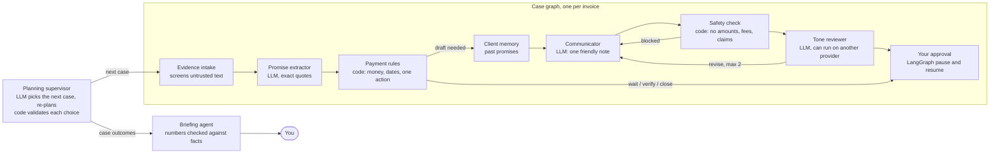

# PromiseKeeper

**A team of AI agents that helps a small agency owner chase overdue invoices without ever chasing money that was already paid.**

Every morning the owner asks: *what happened with this invoice, what can I trust, and what should I do next?* Today that means digging through invoices, bank records and WhatsApp-style promises ("we'll pay 80,000 by the 20th"). PromiseKeeper's agents do that reading, code decides the money, and the owner approves every message. Nothing is ever sent automatically.

## How it works



| Agent | Kind | Can change data? |
|---|---|---|
| Promise extractor | LLM (Nebius) | No: proposes quotes, validated against exact source text |
| Payment rules | Deterministic code | Saves the recommendation |
| Client memory | Store (SQLite, or mem0 when configured) | Only client payment notes |
| Communicator | LLM (Nebius) | No: writes one personal-note paragraph |
| Safety check | Deterministic code | No: blocks numbers, fees, payment claims, instructions |
| Tone reviewer | LLM (Nebius or Fireworks) | No: accepts or asks for a revision |
| Briefing writer | LLM (Nebius) | No: falls back to a plain summary if it states an unsupported number |
| Planning supervisor | LLM (Nebius, own model setting) + code guardrails | Chooses which due case to investigate next or when to finish; never sends, approves or closes |

**Why it is built this way.** In a finance product the AI reads and writes words; code owns every amount, date and action; the owner approves. The agents talk through a typed hand-off protocol (a note can never skip the safety check), every step is recorded with time and tokens in a visible trace, provider outages trip a circuit breaker and fall back to the standard template, and the owner's draft approval resumes the paused LangGraph run, even after a restart.

The owner accepted UX Phases 1 and 2, including read-only comparison of saved investigations and guidance to verify Cedar's payment in external bank/accounting records. [Phase 3](specs/003-owner-experience/phase3-spec.md) completes the presentation with a consistent casebook layout, readable saved-copy and history labels, and a rehearsed fictional STUB demonstration. Its [verification report](reports/owner-experience-phase-iii.md) records the implementation, browser checks and limits of the automated rehearsal. The owner authorized publishing and merging the UX work on 25 October 2026; formal human acceptance remains pending.

## Try it in three commands

```powershell
$env:PK_AGENT_MODE = 'STUB'   # offline stand-ins, no keys needed
uv run --project backend python -m promisekeeper.cli init-demo --catalogue release-0.1 --clock REFERENCE
uv run --project backend python -m promisekeeper.cli serve --host 127.0.0.1 --port 8000 --workers 1
```

Build the UI once (`npm.cmd --prefix frontend ci; npm.cmd --prefix frontend run build`), open `http://127.0.0.1:8000`, and choose **Start morning review**. Then open a case to see the recommendation, the AI team trace and the draft.

The demo has six fictional cases: follow-ups, a promise still in date, two unverified payment claims and a settled invoice. Two customers write in Hinglish. The case overview shows the cases that need attention first; choose **Show all** for the rest.

For real models, set `PK_AGENT_MODE=LIVE` and `NEBIUS_API_KEY` in `.env`. Optional: `PK_SUPERVISOR_MODEL` (a separate, possibly smaller, model for the planning supervisor), `PK_REVIEWER_PROVIDER=FIREWORKS` with `FIREWORKS_API_KEY` (an independent tone reviewer), `LANGSMITH_TRACING=true` with `LANGSMITH_API_KEY` (traces and owner feedback in LangSmith), `MEM0_API_KEY` (hosted client memory), `PK_AUTONOMOUS_REVIEW_MINUTES=30` (the supervisor starts reviews on its own), and `PK_TOKEN_RATES` (cost in the trace). See [.env.example](.env.example).

## Status, honestly

- The fictional engineering build is published; formal Gate V / Release 0.1 acceptance remains pending the actual five-owner study. Historical single-extractor qualification recorded 152 correct returns from 153 attempts, with one provider availability gap, under frozen criteria. That evidence does not qualify the new agents.
- The multi-agent upgrade (branch `002-multi-agent-upgrade`) passes its offline tests: backend, frontend, browser, and six simulated persona walkthroughs ([report](reports/persona-walkthroughs.md)). **The new agents have not yet been measured on live models.** Run `evaluate --suite agents` and `--suite hinglish` in LIVE mode to measure them ([upgrade report](reports/multi-agent-upgrade.md)).
- The planning supervisor ([ADR-011](specs/001-payment-case-mvp/research.md)) passes its offline scenario suite, which proves the harness and guardrails only. **It has not been measured on live models.** Compare candidate models with `evaluate --suite supervisor --catalogue release-0.1 --models <large>,<small>` in LIVE mode ([report](reports/dynamic-supervisor.md)).
- The five-owner usability study has not been run. All data is fictional; there is no authentication and no sending capability.

To try the product by hand, use the [hands-on guide](docs/user-testing/README.md), the [test cases](docs/user-testing/test-cases.md) and the [fictional sample data](docs/user-testing/sample-data.json). The [small-business explanation](docs/user-testing/small-business-pitch.md) has a short pitch and honest answers about current limits.

## Project documents

- [Specification](specs/001-payment-case-mvp/spec.md)
- [Implementation plan and human gates](specs/001-payment-case-mvp/plan.md)
- [Tasks](specs/001-payment-case-mvp/tasks.md)
- [Requirements-quality safety review](specs/001-payment-case-mvp/checklists/safety.md)
- [Setup and validation guide](specs/001-payment-case-mvp/quickstart.md)
- [Gate I review and verification evidence](reports/phase-i.md)
- [Gate II review and verification evidence](reports/phase-ii.md)
- [Gate III implementation and acceptance status](reports/phase-iii.md)
- [Gate IV implementation and verification status](reports/phase-iv.md)
- [Live qualification criteria](reports/live-evaluation-criteria.md)
- [Gate V implementation and verification](reports/phase-v.md)
- [Requirement evidence matrix](reports/acceptance-matrix.md)
- [Release acceptance decision](reports/release-acceptance.md)
- [Multi-agent upgrade plan](docs/superpowers/plans/2026-10-24-multi-agent-upgrade.md) and [ADR-010](specs/001-payment-case-mvp/research.md#adr-010-multi-agent-orchestration-with-langgraph)
- [Multi-agent upgrade report](reports/multi-agent-upgrade.md)
- [Persona walkthroughs (simulated)](reports/persona-walkthroughs.md)

## Development

Use Windows PowerShell, Python 3.12 managed by uv, Node 24, and npm.cmd. Direct local caches into this ignored workspace directory before setup:

```powershell
$repoPath = (Get-Location).Path
$env:UV_CACHE_DIR = Join-Path $repoPath '.runtime\uv-cache'
$env:UV_PYTHON_INSTALL_DIR = Join-Path $repoPath '.runtime\python'
$env:npm_config_cache = Join-Path $repoPath '.runtime\npm-cache'
$env:PLAYWRIGHT_BROWSERS_PATH = Join-Path $repoPath '.runtime\playwright'
uv sync --project backend --frozen
npm.cmd --prefix frontend ci
uv run --project backend pytest
npm.cmd --prefix frontend run typecheck
npm.cmd --prefix frontend run build
npm.cmd --prefix frontend run test:unit
npm.cmd --prefix frontend run test:e2e
```

Use the frozen lockfiles. Browser tests use the installed Chrome channel and start a separate loopback server with a fresh temporary database. Do not run tests against retained demonstration data. Credentials, databases, virtual environments, caches, and build output are excluded from Git.

## Run the case workspace

Create a new fictional copy explicitly, then start the one-worker service:

```powershell
$env:PK_AGENT_MODE = 'STUB'
$env:PK_DB_PATH = Join-Path (Get-Location).Path '.runtime\promisekeeper.sqlite'
uv run --project backend python -m promisekeeper.cli init-demo --catalogue release-0.1 --clock REFERENCE
uv run --project backend python -m promisekeeper.cli serve --host 127.0.0.1 --port 8000 --workers 1
```

`init-demo` always creates a fresh copy; restarting `serve` preserves existing copies. Only one process may own a database. `/api/v1/health`, `/api/v1/demonstrations` and the generated `/docs` expose the current API. Case, source, history and scenario routes require a `demonstration_id` query parameter. Mutations require JSON and `X-PromiseKeeper-Request: 1`; obtain the exact case-bound fixture preview before confirming an event. Keep the same operation ID and payload when reconciling an unknown outcome.

Build the frontend before serving, then open `http://127.0.0.1:8000`. Select a retained copy, inspect its three cases and source versions, and explicitly investigate when ready. STUB uses approved extraction packets through the same runtime validation and deterministic rules as LIVE.

Open **Review** to edit and explicitly approve or reject an exact saved draft. **History** provides prior results and source versions, advice decisions, fictional update previews, and explicit closure/reopening or selected-copy deletion. Each confirmation rechecks the saved case; approval never sends a message.

For Nebius configuration, copy [.env.example](.env.example) to the ignored `.env` and set `NEBIUS_API_KEY`. The backend reads this file; existing process variables take precedence. Keys stay outside frontend code. `PK_NEBIUS_MODEL` selects one explicit Nebius model; there is no automatic provider/model fallback. Keep `PK_AGENT_MODE=STUB` for offline demonstrations. A live candidate must pass the recorded extraction evaluation before Gate III acceptance:

```powershell
uv run --project backend python -m promisekeeper.cli evaluate --suite live --catalogue release-0.1 --repeats 3 --output reports/live-evaluation-new.json
```

This explicit command makes real Nebius calls even when the interactive workspace is configured STUB. See the Gate III report for actual results and unexecuted checks. The owner approved and committed Gate II as `9b0da8f`, then authorized Gate III and selected Nebius. The owner authorized Gate IV publication and Gate V implementation on 24 October 2026; release acceptance still requires the recorded checks and actual human observations.

## Gate V verification commands

Run the fixture report offline without credentials. Each output path must be new; preserve earlier failed reports.

```powershell
uv run --project backend python -m promisekeeper.cli evaluate --suite fixtures --catalogue release-0.1 --output reports/fixture-evaluation-new.json
```

The following measurement commands require the explicitly configured LIVE Nebius model and make real provider calls in isolated temporary copies. HTTP timing is separate from browser display timing; neither establishes extraction qualification.

```powershell
$env:PK_AGENT_MODE = 'LIVE'
$env:PK_NEBIUS_MODEL = 'zai-org/GLM-5.3-Flash'
uv run --project backend python -m promisekeeper.cli measure --suite responsiveness --trials-per-case 10 --report reports/responsiveness-new.json
uv run --project backend python -m promisekeeper.cli measure --suite preservation --cycles 10 --report reports/preservation-new.json
```

For the opt-in real browser measurement, after building the UI:

```powershell
$env:PROMISEKEEPER_LIVE_MEASUREMENT = '1'
$env:PROMISEKEEPER_LIVE_BROWSER_REPORT = Join-Path (Get-Location).Path 'reports/live-browser-responsiveness-new.json'
node frontend/node_modules/@playwright/test/cli.js test --config tests/e2e/live.playwright.config.ts
Remove-Item Env:\PROMISEKEEPER_LIVE_MEASUREMENT
```

Default browser tests skip the LIVE measurement. The [owner-study protocol](reports/owner-evaluation-protocol.md) and [blank observations](reports/owner-observations.csv) require actual participants. Automated passes cannot populate those results or authorize a production release. See the final acceptance reports for executed outcomes.
