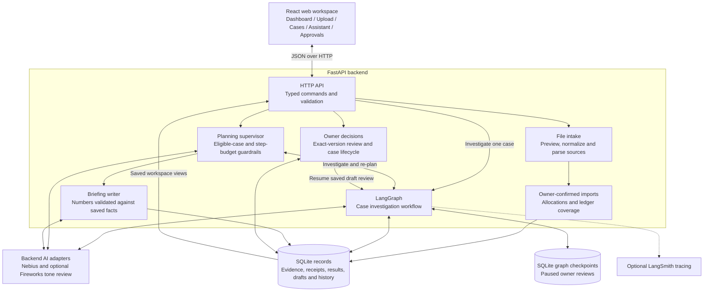
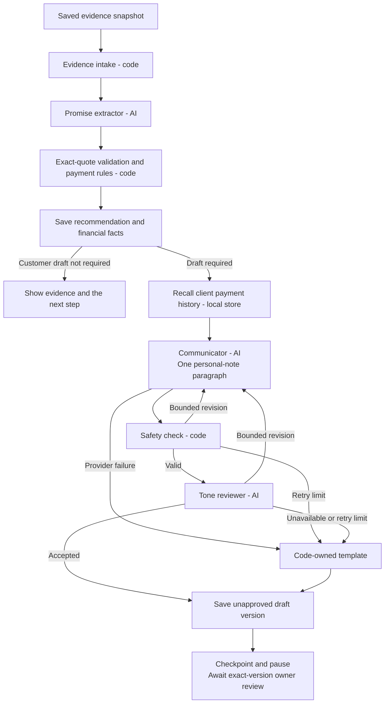

# PromiseKeeper

**A source-grounded assistant for invoice follow-ups and payment reconciliation.**

PromiseKeeper brings invoices, bank receipts and customer messages into one workspace so a business owner can answer three questions: **What happened? What can I trust? What should I do next?** AI agents interpret evidence and prepare wording; deterministic code calculates balances, chooses the supported next step and validates command eligibility; the owner reviews every action.

## What it does

- Imports customer, invoice, receipt and allocation CSV files, plus plain-text email and WhatsApp records.
- Previews and validates files before an explicit import confirmation.
- Suggests payment matches while keeping invoice allocation and settlement confirmation under owner control.
- Tracks partial payments, expired promises, future commitments and unsupported payment claims.
- Plans a morning review, investigates eligible cases and prepares a source-linked briefing.
- Preserves exact source versions, investigation history, draft versions and owner decisions.
- Supports exact-version draft approval and manual copying, with separate confirmation for case closure.

## User workflow

### 1. Bring in the records

The **Upload** page guides the owner through six steps:

| Step | Owner action | Result |
|---|---|---|
| Customers | Upload customer identities, aliases and addresses | A separate upload workspace |
| Invoices | Add invoices associated with those customers | One case per invoice |
| Bank receipts | Upload a receipt export or supported bank CSV | Receipts retained independently of invoices |
| Customer messages | Attach email or WhatsApp text to an invoice and review the sender | Source-linked promises, claims or supporting context |
| Match payments | Review hints and explicitly allocate receipts | Confirmed partial, full or split allocations |
| Confirm & check | Confirm payment-record coverage and start Morning Review | Current recommendations and eligible reminder drafts |

Every file has a read-only preview. Name or address similarity is a hint, not an automatic allocation. Uncertain receipts can remain unallocated.

### 2. Review the next step

Run **Start morning review** for a planned review of eligible cases, or **Investigate case** to check one invoice. Each completed investigation recommends one action:

| Action | Meaning |
|---|---|
| **Follow up** | Review a reminder for an overdue, supported remainder |
| **Wait** | Return at the next review boundary, such as a future promise date |
| **Verify payment** | Resolve a claim, missing record or conflicting evidence before a demand |
| **Review case closure** | Verified settlement supports an explicit closure decision |

A recommendation does not approve a message or close a case. Accepting advice, approving wording and confirming closure are separate decisions.

### 3. Work across the workspace

| Page | Purpose |
|---|---|
| **Dashboard** | See balances, urgent cases, pending decisions and the latest morning review |
| **Upload** | Add records, match payments and confirm coverage |
| **Cases** | Open an invoice's story, evidence, history and saved-investigation comparison |
| **Assistant** | Inspect the team's plan, case activity and optional technical details |
| **Approvals** | Review reminder drafts, recommendations, payment checks and closures in one queue |

Edit a reminder if needed, save a new version, then approve that exact saved version before copying it to your communication tool. **Approval never sends a customer message.** New evidence, changed wording or a new investigation can invalidate earlier approval and require a fresh review.

When a later receipt arrives, import it, allocate it, reconfirm coverage and investigate again. Earlier results remain available in **History** and **Compare**.

## Architecture

### Application and data boundaries



The frontend uses hash routes so individual case links survive refresh. A shared workspace store keeps the Dashboard, case pages and approval queue aligned after decisions. FastAPI serves both the built interface and the API; SQLite stores the business records, with a separate SQLite checkpoint file for paused graph execution.

### Case investigation and writing pipeline



AI roles use scripted stand-ins in **STUB** mode and configured providers in **LIVE** mode. Intake's supported communication parser runs locally without a model call. During investigation, extractor proposals still pass exact-source validation before the rules engine uses them.

The recommendation is saved before message preparation, so a writing failure does not erase an investigation result. Note generation is bounded to two attempts; unsupported wording or writing-provider failure falls back to a validated template. Extraction failures remain visible rather than producing invented financial facts.

### Responsibilities

| Component | Responsibility |
|---|---|
| Planning supervisor | Select the next eligible case and re-plan after each outcome; code validates every move |
| Promise extractor | Propose promises and payment claims anchored to exact source spans |
| Payment rules | Reconcile amounts, dates, allocations and evidence into one next action |
| Client memory | Recall saved payment history within the selected workspace |
| Communicator | Write a personal note while factual clauses remain code-owned |
| Safety check | Validate the draft against supported amounts, claims, wording and recipient |
| Tone reviewer | Accept the note or request a bounded revision |
| Briefing writer | Summarize outcomes with numeric validation and a fallback summary |
| Owner | Confirm imports and allocations, review advice and drafts, and explicitly close or reopen cases |

## Technology stack

| Layer | Technology |
|---|---|
| Interface | React 19, TypeScript, Vite, CSS |
| API and contracts | Python 3.12, FastAPI, Pydantic |
| Agent orchestration | LangGraph with SQLite checkpoints |
| Persistence | SQLite, migrations, versioned evidence and operation receipts |
| AI integration | Nebius; optional Fireworks tone reviewer |
| Observability | Saved agent activity; optional LangSmith traces |
| Verification | pytest, Vitest, Testing Library and Playwright with Chrome |

## Getting started

### Prerequisites

- Python **3.12** and **uv**.
- Node.js **24** and npm.
- Google Chrome for browser tests.

The commands below run from the repository root in Windows PowerShell.

### Install and build

```powershell
$repoPath = (Get-Location).Path
New-Item -ItemType Directory -Force -Path (Join-Path $repoPath '.runtime') | Out-Null
$env:UV_CACHE_DIR = Join-Path $repoPath '.runtime\uv-cache'
$env:UV_PYTHON_INSTALL_DIR = Join-Path $repoPath '.runtime\python'
$env:npm_config_cache = Join-Path $repoPath '.runtime\npm-cache'
$env:PLAYWRIGHT_BROWSERS_PATH = Join-Path $repoPath '.runtime\playwright'

uv sync --project backend --frozen
npm.cmd --prefix frontend ci
npm.cmd --prefix frontend run build
```

### Start the application

```powershell
$env:PK_AGENT_MODE = 'STUB'
$env:PK_DB_PATH = Join-Path $repoPath '.runtime\promisekeeper.sqlite'
uv run --project backend python -m promisekeeper.cli serve --host 127.0.0.1 --port 8000 --workers 1
```

Open **http://127.0.0.1:8000** and choose **Upload** to create a workspace from fictional records. Storage and migrations initialize on startup; restarting the service preserves existing workspaces. Only one process may own a database.

- Interactive API reference: **http://127.0.0.1:8000/docs**
- Readiness and safe configuration: **http://127.0.0.1:8000/api/v1/health**

**STUB** mode needs no provider key. For provider-backed execution, use the [configuration template](.env.example), set `PK_AGENT_MODE=LIVE`, supply the required backend credentials and restart the service. Credentials stay in the ignored `.env` or process environment, never in frontend code; process variables take precedence.

## Configuration

| Setting | Purpose |
|---|---|
| `PK_AGENT_MODE` | `STUB` for offline execution or `LIVE` for provider-backed agents |
| `PK_DB_PATH` | Absolute SQLite path inside the repository workspace |
| `PK_NEBIUS_MODEL` | Explicit Nebius model for the main AI roles |
| `NEBIUS_API_KEY` | Backend credential required for LIVE Nebius calls |
| `PK_SUPERVISOR_MODEL` | Optional separate planning model; otherwise uses the main model |
| `PK_REVIEWER_PROVIDER` | `NEBIUS` or `FIREWORKS` for tone review |
| `PK_FIREWORKS_MODEL`, `FIREWORKS_API_KEY` | Model and backend credential for the optional Fireworks reviewer |
| `LANGSMITH_TRACING`, `LANGSMITH_API_KEY` | Optional external tracing |
| `PK_AUTONOMOUS_REVIEW_MINUTES` | Periodic morning reviews; `0` disables scheduling |

Scheduled reviews still retain the same owner decision controls. They do not approve wording, allocate receipts or close cases on the owner's behalf.

## Verification

Run the offline checks after building the interface:

```powershell
uv run --project backend pytest -p no:cacheprovider --basetemp=.runtime/pytest-readme-check
npm.cmd --prefix frontend run test:unit
npm.cmd --prefix frontend run typecheck
npm.cmd --prefix frontend run build
npm.cmd --prefix frontend run test:e2e
```

Browser checks use an isolated loopback server and a fresh database. Run builds and browser suites sequentially because they share the built frontend. LIVE evaluations are separate, opt-in operations.

Latest recorded verification, **26 October 2026**:

| Check | Result |
|---|---|
| Backend, final full publication rerun | 1,391 passed; one intentional LIVE skip |
| Frontend unit | 240 passed |
| TypeScript and production build | Passed |
| Full serial Chrome | 100 passed; one intentional LIVE skip |
| Historical offline evaluation | Primary set 65/65; expanded set 90/90 (includes the primary set), at the [documented checkpoints](reports/system-eval-fixes.md) |

The [publication verification report](reports/product-007-publication.md) records the combined changes and preserves the initial SQLite writer-lock failure, unchanged passing rechecks and final full rerun. [Earlier verification](reports/multi-page-ux.md) retains its original failures and fixes. [System evaluation findings](reports/system-eval-fixes.md) distinguish supported behavior, safety failures that were corrected and remaining limits. These results establish offline engineering behavior, not broad LIVE qualification or human usability acceptance.

## Reliability and decision boundaries

- **Source grounding:** original files and exact evidence versions remain inspectable; customer claims are kept distinct from verified payment records.
- **Deterministic money:** code handles monetary precision, invoice allocation, payment status and review dates. Unknown balances are shown as unknown and excluded from known totals.
- **Explicit decisions:** imports, settlement assertions, allocations, exact draft versions and case closure each retain their own confirmation.
- **Recovery:** retained operation IDs and receipts reconcile uncertain outcomes without duplicating writes; graph checkpoints preserve paused reviews across restarts.
- **Traceability:** saved investigations and draft versions remain available for comparison after new evidence or later payment.
- **Bounded autonomy:** supervisor choices are validated against eligible cases and execution budgets, with rule-order fallback when planning fails.

## Current limitations

This is a local prototype without authentication. Use fictional records only. Upload workspaces support INR, up to six invoice cases, documented CSV profiles, files up to 256 KiB and at most 100 CSV data rows. Communication intake accepts supported plain-text forms; unfamiliar signatures, conditional wording, encoded bodies and ambiguous source spans can be refused.

Records are uploaded manually; there are no active bank, email or WhatsApp connectors. Matching hints do not establish ownership, coverage confirmation is an owner assertion, and the application has no customer-sending capability. Broader LIVE qualification and a formal human usability study remain outstanding.

## Repository layout

```text
backend/src/promisekeeper/   API, application services, agents, rules and persistence
backend/tests/              Contract, domain, integration and evaluation checks
frontend/src/               Pages, shared workspace state and review components
frontend/tests/             Interface and state-transition checks
tests/e2e/                  Browser journeys, accessibility and restart recovery
evals/system/               Independent scenario definitions
scripts/                    Offline evaluation tooling
docs/                       Workflow and design documentation
reports/                    Verification evidence and known limitations
specs/                      Requirements, plans and architecture decisions
```

## Further reading

- [Core requirements](specs/001-payment-case-mvp/spec.md)
- [Architecture decisions](specs/001-payment-case-mvp/research.md)
- [Workspace design](docs/superpowers/specs/2026-10-26-multi-page-ux-design.md)
- [Independent scenario guide](evals/system/README.md)
- [Requirement evidence matrix](reports/acceptance-matrix.md)
