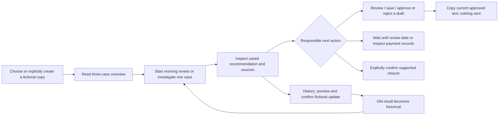

# PromiseKeeper: current-state audit

**Date:** 25 October 2026 (IST). **Audited checkout:** `002-multi-agent-upgrade`, commit `1f13b86`. **Status:** review documentation; no implementation authorized by this document.

## Finding

PromiseKeeper is a substantial local, fictional-data engineering prototype with a defensible product idea: avoid an unjustified payment demand by separating a customer's words from verified payment evidence. It already supports a complete evidence-to-decision-to-human-review journey. The multi-agent branch adds genuine orchestration and constrained language tasks. Its next useful increment is clearer presentation of existing decisions and changes, rather than another agent or a new application shell.

It is not yet an accepted production SaaS product. There is no authentication, real-data intake or customer sending. The new agents lack LIVE evaluation, and the required five-owner study remains unexecuted. Publication, automated tests and simulated personas do not establish that acceptance.

## How to read this review

- **Verified:** inspected implementation or explicit contents of an existing artifact.
- **Retained evidence:** an earlier report or saved screenshot, inspected now; not a newly executed test.
- **Inference:** a usability or reliability implication of those observations, requiring validation.
- **Proposal:** an unimplemented recommendation for owner review.
- **Unknown:** not established by the inspected evidence.

The audit read the README, constitution, Spec Kit workflow/templates, original specification/plan/tasks/ADR-010, frontend components and CSS, backend routes/contracts/application services, agents and both graphs, persistence/recovery, fixtures, relevant tests and retained evaluation/review reports. Four retained persona screenshots were visually inspected: initial workspace, Findings with trace, message review, and the mobile/large-text header. They illustrate prior STUB runs; they are not proof of a fresh run of this checkout. No application server, application test suite, LIVE evaluation or human study was run for this audit. No credentials were inspected. Current external provider connectivity, active configuration and remote PR state are unknown.

Review documents:

1. This audit: verified behavior and limits.
2. [UX gap analysis](UX_GAP_ANALYSIS.md): observations, implications and recommendations.
3. [Proposed user journey](PROPOSED_USER_JOURNEY.md): minimum structure, six surface assessments and design guidance.
4. [Improvement backlog](UX_IMPROVEMENT_BACKLOG.md): competition priorities and tradeoffs.
5. [Phased implementation plan](PHASED_IMPLEMENTATION_PLAN.md): proposed acceptance criteria and review gates.
6. [Five-minute demo plan](BUILDER_OF_THE_WEEK_DEMO_PLAN.md): a source-grounded sequence and fallbacks.

## 1. Implemented capability inventory

| Capability | Verified behavior | Evidence |
| --- | --- | --- |
| Retained fictional workspaces | Explicitly create three-case copies; list/select existing copies; preserve valid browser selection. Reload does not silently reseed. | [cases.py:15](../../backend/src/promisekeeper/application/cases.py#L15), [App.tsx:42](../../frontend/src/App.tsx#L42), [DemonstrationPicker](../../frontend/src/cases/DemonstrationPicker.tsx) |
| Case overview | Client, invoice, due date, lifecycle, recorded/verified/unknown remainder, current recommendation and next review. Running/stale results suppress current overview advice. | [cases.py:138](../../backend/src/promisekeeper/application/cases.py#L138), [CaseList](../../frontend/src/cases/CaseList.tsx) |
| Original evidence | Invoice, ledger and message records, availability, verification, authority, versions and exact source dialog. Historic and superseded records remain inspectable. | [CaseEvidence](../../frontend/src/cases/CaseEvidence.tsx), [SourceViewer](../../frontend/src/cases/SourceViewer.tsx) |
| Investigation | Snapshot capture, candidate extraction with exact source validation, deterministic reconciliation, one of FOLLOW_UP/WAIT/VERIFY_PAYMENT/CLOSE, explicit COMPLETE/LIMITED/INCOMPLETE distinctions. | [start_investigation.py:10](../../backend/src/promisekeeper/application/start_investigation.py#L10), [case_graph.py:125](../../backend/src/promisekeeper/orchestration/case_graph.py#L125), [recommendations.py:27](../../backend/src/promisekeeper/domain/recommendations.py#L27) |
| Supported explanations | Saved financial facts, commitments, claims, questions, contradictions, source links and next step; outdated results are labelled historical. | [findings.py:7](../../backend/src/promisekeeper/application/findings.py#L7), [FindingsView](../../frontend/src/investigations/FindingsView.tsx) |
| Guided journey | Evidence → recommendation → action appropriate to the result. WAIT and internal verification do not promise a customer draft. | [CaseJourney](../../frontend/src/cases/CaseJourney.tsx), [format.ts](../../frontend/src/components/format.ts) |
| Human draft review | Persisted versions, constrained editing, exact-version approve/reject, validation guidance, unsaved buffers and pending-command recovery. Approval never sends. | [DraftReview](../../frontend/src/reviews/DraftReview.tsx), [reviews.py](../../backend/src/promisekeeper/application/reviews.py) |
| Approved-message handoff | Copy only the current exact approved text; block unsaved, stale, pending or updating contexts; offer manual copying if clipboard access fails. | [DraftReview.tsx:45](../../frontend/src/reviews/DraftReview.tsx#L45), [caseActivity](../../frontend/src/api/caseActivity.ts) |
| Human case decisions | Advice acceptance/rejection, separately confirmed closure/reopening, and separate message approval. CLOSE advice alone does not close a case. | [OwnerDecisions.tsx:18](../../frontend/src/history/OwnerDecisions.tsx#L18), [lifecycle.py](../../backend/src/promisekeeper/application/lifecycle.py) |
| Arrival and reinvestigation | Preview and explicitly confirm registered fictional evidence/clock updates; mark prior advice historical; preserve earlier results and decisions. | [ScenarioUpdate](../../frontend/src/history/ScenarioUpdate.tsx), [scenario_updates.py](../../backend/src/promisekeeper/application/scenario_updates.py) |
| History and recovery | Sequence-paginated immutable events, direct historic result/draft reads, operation receipts, revision/epoch fences, restart recovery and explicit retries. | [CaseHistory](../../frontend/src/history/CaseHistory.tsx), [repositories.py:128](../../backend/src/promisekeeper/persistence/repositories.py#L128), [recovery.py](../../backend/src/promisekeeper/persistence/recovery.py) |
| Multi-agent experience | Running and saved agent events, typed recipient/message labels, optional draft trace, provider roster, owner feedback, morning review and briefing. | [AgentTrace](../../frontend/src/agents/AgentTrace.tsx), [MorningReview](../../frontend/src/agents/MorningReview.tsx), [agent_activity.py](../../backend/src/promisekeeper/application/agent_activity.py) |

### Incomplete, deferred or deliberately absent

- **Comparison is not implemented.** The original [US6/AC-28](../../specs/001-payment-case-mvp/spec.md#user-story-6---see-what-changed-since-the-prior-investigation-priority-p1) and FR-024 describe it, while [tasks.md:214](../../specs/001-payment-case-mvp/tasks.md#L214) explicitly defers it. History can support a manual comparison today.
- The Timeline tab is an **evidence chronology**, not an enriched promise-status timeline. It shows source/version, kind, availability, event time and arrival time, rather than the promise's amount, due date and fulfillment together.
- Real customer/invoice import, WhatsApp/Gmail connectors, arbitrary uploads, authentication, delivery and voice briefing are absent from this product scope. Their absence is not a reason to add them before submission.
- Feedback and approved-edit pairs are recorded; automatic fine-tuning or demonstrated learning improvement is not established.
- Real-model quality of the new writing/reviewer/briefing agents, hosted memory, and the human usability outcomes remain unmeasured.

## 2. Existing owner journey

The current shell has a header/AI roster, mode/time disclosure, copy picker, Morning Review panel, case cards and a case workspace. Inside a case are the guided journey, investigation controls and five tabs: Evidence, Findings, Timeline, Review and History. Advice decisions appear in Findings and History; message approval is in Review; fictional updates are in History. This is a working case-centric interface, not a chatbot.

There is no portfolio of live customer accounts: these are three registered examples per copy. “Verified” means the fictional catalogue's designated ledger evidence meets the implemented rules, not that a bank was contacted.

## 3. Frontend and visual system

**Verified:** React/TypeScript with Vite; hand-written CSS; native buttons, selects, textareas, details and dialog; no installed component design system or client router is used by the inspected shell. [package.json](../../frontend/package.json), [App](../../frontend/src/App.tsx), [styles.css](../../frontend/src/styles.css).

The current identity is a restrained casebook: Georgia display headings, Arial body text, ink `#172d35`, blue `#24576a`, muted text `#52666d`, warm workspace `#f6f5ef`, white paper and amber notices. CSS includes visible focus, wrapping, reduced-motion rules, 1000/720/430px adaptations and a horizontally scrollable mobile case overview. INR values use BigInt formatting; display instants use Asia/Kolkata with an IST label in [format.ts](../../frontend/src/components/format.ts).

**Retained visual observation:** Findings expands a long trace before showing its financial summary and owner decisions. The completed Morning Review also repeats case choices above the permanent case cards. The mobile/200% header devotes considerable height to branding and disclosure. These support hierarchy/density recommendations; they do not establish an overflow failure or a fresh accessibility conformance result.

## 4. Actual agent and graph responsibilities

| Participant | Implementation and authority |
| --- | --- |
| Evidence intake | Code reads the captured snapshot, detects instruction-like customer text and records a bounded event. |
| Promise extractor | Nebius LLM in LIVE; scripted stand-in in STUB. Proposes message candidates. Exact spans, schemas and deterministic rules validate their use. |
| Payment rules | Deterministic code owns money, dates, uncertainty, recommendation, result hash and save. It is not an autonomous LLM strategist. |
| Client memory | Copy-scoped SQLite facts by default; optional mem0 adapter. Context for the note only, not financial authority. |
| Communicator | LLM proposes one warmth-only paragraph. The factual message remains template-owned. |
| Safety check | Deterministic note and full-draft validation. Rejects unsupported content. |
| Tone reviewer | LLM accepts or requests revision of the note; optional Fireworks provider. It cannot approve the owner's message. |
| Owner review | LangGraph interrupt for a successfully prepared draft. The recorded backend review is authoritative; graph resume is best-effort. |
| Morning supervisor | A second LangGraph uses deterministic case-selection rules and sequentially invokes case investigations. It is not an LLM deciding which invoices matter. |
| Briefing writer | LLM summarizes supplied facts; numeric checks can trigger deterministic fallback. This check is not proof of complete semantic correctness. |

Source: [case_graph.py](../../backend/src/promisekeeper/orchestration/case_graph.py), [morning_review.py](../../backend/src/promisekeeper/orchestration/morning_review.py), [roster.py](../../backend/src/promisekeeper/agents/roster.py), [briefing.py:51](../../backend/src/promisekeeper/agents/briefing.py#L51), [memory.py](../../backend/src/promisekeeper/agents/memory.py).

The case graph has **at most two personal-note attempts**, including the initial attempt, before fallback; this is not two revisions after the first draft. WAIT/CLOSE and other no-draft paths can end without an owner-review interrupt. AI exceptions can preserve the recommendation while producing a standard template or a failed, retryable draft. The circuit breaker applies to the new agents' shared chat client, not the unchanged extractor adapter. Optional autonomy starts the same review periodically; it never approves, sends or closes.

Agent messages name allowed sender/recipient/kind relationships in [messages.py](../../backend/src/promisekeeper/agents/messages.py). The graph's control flow and deterministic validation enforce the actual safety path. The activity recorder is best-effort and catches recording/protocol failures; its visible trace is useful explanatory evidence, not a guaranteed complete security audit or hidden reasoning transcript.

## 5. APIs, tools, integrations and persistence

- Existing versioned reads cover health/configuration, catalogue, copies, cases, exact evidence versions, case history, investigations with saved results/activity, and morning reviews. Copy scoping uses `demonstration_id`. [client.ts:42](../../frontend/src/api/client.ts#L42), [api/app.py:110](../../backend/src/promisekeeper/api/app.py#L110).
- Existing writes cover investigation starts, exact draft versions/reviews/retries, advice dispositions, confirmed lifecycle actions, fixture preview/confirmation and feedback. They do not accept arbitrary financial edits or send messages.
- Evidence tooling reads only requested IDs from a hash-checked immutable snapshot, enforces packet limits and never imports an external inbox. [tools/evidence.py](../../backend/src/promisekeeper/tools/evidence.py).
- Nebius is implemented; Fireworks reviewer, LangSmith tracing/feedback and mem0 are optional code paths. Their presence is not proof of configuration, connectivity or LIVE qualification. mem0 transport has mocked evidence only. No new integration is recommended for P0.
- SQLite holds copy-scoped evidence/projections, snapshots, results, immutable draft/review/history records, receipts, activity, feedback, morning reviews and memory. A separate `-graph.sqlite` stores paused graph state. One process owns the database; restart recovery marks interrupted investigations/drafts/reviews terminal rather than replaying model work. [sqlite.py](../../backend/src/promisekeeper/persistence/sqlite.py), [case_graph.py:72](../../backend/src/promisekeeper/orchestration/case_graph.py#L72), [migrations](../../backend/src/promisekeeper/persistence/migrations).
- The service restricts Host/Origin to loopback/local development and requires JSON plus a custom mutation header. This is a fictional local-demo boundary, not authentication or a hosted SaaS security model. [app.py:59](../../backend/src/promisekeeper/api/app.py#L59).

## 6. Existing verification and governance limits

The retained [multi-agent upgrade report](../../reports/multi-agent-upgrade.md#verification-actually-run) reports a final serial run of **868 backend passes and one skip, 104 frontend unit passes, successful typecheck/build, and 86 Chrome passes and one skip**, including six simulated persona journeys. These are reported prior results, not tests run for this audit. [persona-walkthroughs.md](../../reports/persona-walkthroughs.md) explicitly distinguishes simulation from a user study. Relevant source includes graph/safety/recovery/memory/morning-review integration tests, frontend agent/review tests and browser persona/restart/UX suites.

The historical single-extractor qualification recorded 152 correct returns from 153 attempts with one provider availability gap. It does not qualify the new agents or establish current branch end-to-end LIVE performance. Offline agent/Hinglish evaluations demonstrate harness behavior; the Hinglish harness is not the production anchored extractor, and judge calibration is blank. See [upgrade report:50](../../reports/multi-agent-upgrade.md#L50).

There are material documentation inconsistencies to resolve with approval, not silently edit:

1. README says Release 0.1 is published; [release-acceptance.md:3](../../reports/release-acceptance.md#L3) and unchecked T095/T098–T100 establish **formal acceptance pending**. Publishing the fictional engineering build is the supported claim.
2. Constitution v1.0.0 Principle IV restricts specialized roles to Investigator/Strategist/Communicator. Current code has separate extractor, communicator, tone reviewer and briefing LLM paths; ADR-010 amends ADR-002 but is not itself a recorded constitutional amendment. Existing plans/contracts also describe the older one-agent architecture. Reconcile policy, feature scope and traceability before dependent implementation. No constitutional compliance pass is inferred here.
3. AC-28/FR-024 remain deferred. Calling comparison “competition P0” in this review is a proposal, not a change to their approved MVP priority or task status.

The main constitutional cutoff is **26 October 2026, 10:00 IST**. A stale open-decision reference to 25 October is already identified in [plan.md:62](../../specs/001-payment-case-mvp/plan.md#L62); it is not an alternate permission to change scope.

## 7. Demonstration risks and unknowns

| Risk / unknown | Evidence and practical implication |
| --- | --- |
| New LIVE behavior unmeasured | Do not promise real-model success, tone quality or five-minute duration from STUB evidence. Obtain separate authorization for evaluation. |
| Morning review can outlast a single case | Sequential case calls plus briefing; UI follow-up budget is 120 seconds, while individual investigation watchdog is 60 seconds. Rehearse and maintain an inspectable saved fallback. |
| Provenance mismatch for LIVE morning starts | Morning graph omits explicit mode/model when calling a start function whose default mode is STUB. This is a source-verified reporting risk, not a display-copy fix. [morning_review.py:141](../../backend/src/promisekeeper/orchestration/morning_review.py#L141), [start_investigation.py:10](../../backend/src/promisekeeper/application/start_investigation.py#L10). |
| Optional services add failure paths | Hosted memory calls sit outside the case's shared deadline logic; feedback forwarding is synchronous. Default to local memory and no optional remote demonstration dependency; configuration was not inspected. |
| Incomplete trace / checkpoint lifecycle | Activity recording is best-effort; graph resume checks for any next node, and checkpoint cleanup on copy deletion is absent from the inspected delete service. These are retained technical risks, not grounds to claim approval corruption. |
| Busy and restart behavior | One execution slot can reject a manual investigation during a supervisor pass. Earlier reports retain load-related startup timeouts. Rehearse serially on isolated fictional copies. |
| UX outcomes | Actual task speed, willingness to pay, screen-reader usability, contrast measurements, fresh browser appearance and official competition rules/rubric are unknown. The supplied seven criteria are working criteria only. |

**Decision:** retain the existing architecture and safeguards; prioritize decision hierarchy and a read-only, evidence-linked comparison. All proposed work remains subject to owner review and the existing Spec Kit gates.
