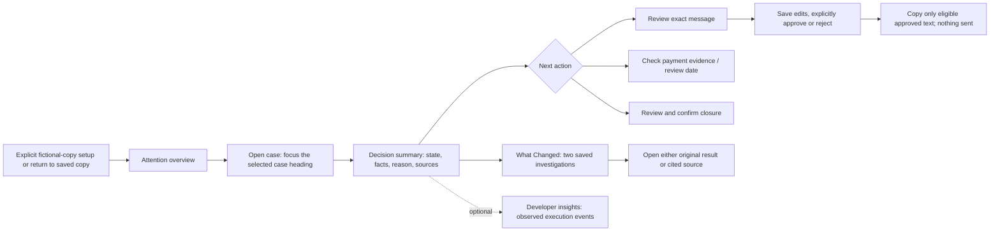

# PromiseKeeper: proposed owner experience

**Date:** 25 October 2026. **Baseline:** `002-multi-agent-upgrade` / `1f13b86`. **Status:** proposal for review, not an approved specification.

Verified behavior and evidence are in [CURRENT_STATE_AUDIT.md](CURRENT_STATE_AUDIT.md). All new layouts, labels, interactions and comparison behavior below are proposals.

## Product promise and recommended structure

“Know whether to follow up, wait, verify a payment or review closure—and see the evidence behind it.” Lead with that owner outcome. Agents support the work; they are not the owner's navigation model.

Three approaches were considered:

| Approach | Benefit | Tradeoff / recommendation |
| --- | --- | --- |
| Refine the current casebook and add a comparison within Findings | Reuses current APIs, identity, selections, safety controls and tests. | **Recommended.** Most competition value for the smallest behavioral change. |
| Create new Command Center, workspace and standalone comparison routes | Clearer long-term information architecture and deep links. | More routing/state/selection/accessibility work; defer until real usage shows the need. |
| Build all six suggested surfaces as separate screens | Gives every concept its own destination. | Too much navigation for three cases; duplicates evidence/decision state. Not recommended. |

Use **two primary surfaces within the existing app**: an attention overview and the selected case workspace. Promise Timeline, Decision/Approval and What Changed are parts of that workspace. Developer insights is an optional disclosure, not another required destination. Retain the current five tabs in P0; merging Timeline into Evidence or renaming tabs is a later, separately tested navigation decision.

## Proposed journey



### Existing versus proposed

Overview, explicit setup, case selection, evidence, supported next actions, exact review, copy, closure, historical inspection and agent events already exist. Decision-first order, focused case opening, compact developer disclosure and What Changed are proposed refinements. No diagram node authorizes implementation.

## Surface 1: Command Center / attention overview

- **Primary goal:** choose the next case needing attention without interpreting agent configuration.
- **Essential information:** current copy and its fixed/real evaluation time; three clients/invoices; server-labelled balance and current action; review-required/closed state; next review; morning-review status and saved briefing.
- **Primary CTA:** “Start morning review” on an unreviewed portfolio; “Open case” on a saved outcome. Explain that the review investigates due cases and prepares drafts, not messages sent to customers.
- **Layout:** compact introduction and copy picker, then attention list; collapse an already-read briefing to a short summary with an expand control. Reuse existing case cards rather than building a second metrics dashboard. Avoid a portfolio “money owed” total while any balance is unknown/contested.
- **States:** no copies → explicit standard example creation; several copies → explicit chooser; not reviewed → explain the first action; working → last confirmed progress with safe access to cases; partial/failed case outcome → show that outcome without declaring the whole portfolio healthy; unavailable latest-review read → retry rather than pretending there was no review.
- **Navigation:** explicit case opening reveals/focuses its heading, including the already-selected case. Automatic refresh retains focus and scroll. Returning retains copy selection.
- **Backend dependencies:** existing copy/catalogue/case reads and morning-review start/latest/detail endpoints. P0 uses existing order and flags; optional attention sorting must not invent a financial priority score.
- **Reuse:** `MorningReview`, `CaseList`, `DemonstrationPicker`, `StatusBanner`, `ApiClient`, `money`/`instant`/`words`.

The label “today” must mean the selected copy's business date. A fixed-date demonstration must not imply that its 23 October facts were evaluated on the computer's current day.

## Surface 2: Case Investigation Workspace

- **Primary goal:** understand one invoice and reach a supported next step.
- **Essential information:** client/invoice, current versus historical result, evaluated time, invoice/verified paid/remainder with certainty label, unresolved question, concise recommendation, source links and eligible owner action.
- **Primary CTA:** action-specific: review message, inspect payment evidence, view review date, or review closure. Starting an investigation remains available when needed; it is not the dominant action over an already-current decision.
- **Layout:** case identity → status → money and uncertainty → concise explanation/key sources → primary action → optional comparison → supporting evidence/commitments → Developer insights. A compact saved/fallback status may appear beside the decision; the expanded trace no longer precedes money.
- **States:** uninvestigated; investigating; result saved/draft preparing; current; limited; historical after evidence/time change; incomplete attempt with earlier saved result retained; closed with new evidence needing review. Historical comparisons and earlier results offer inspection, not current approvals.
- **Navigation:** existing case selection and tabs. Keep the journey links as shortcuts with consistent names, not a second competing set of page concepts.
- **Backend dependencies:** existing case/attempt/evidence reads and existing commands. Currentness and `allowed_commands` remain server-owned. Presentation must not recalculate recommendation or closure eligibility.
- **Reuse:** `CaseJourney`, `InvestigationControls`, `FindingsView`, `FinancialSummary`, `OwnerDecisions`, `SourceViewer`, `FeedbackButtons`.

### Text wireframe: the decision area

```text
Cedar Retail Labs · CR-312               Current / evaluated 23 Oct, 11:05 IST
Review case closure
Invoice INR 90,000 | Verified paid INR 90,000 | Verified remainder INR 0
The saved records support settlement. Closure still needs your confirmation.
[View the verified settlement record]    [Review case closure]

What changed since the prior investigation?
Verify payment → Review case closure
Recorded, contested remainder INR 60,000 → Verified remainder INR 0
Newly available in this investigation: verified ledger record CR-T2.
[Compare saved investigations]  [Open previous result]

Supporting evidence / commitments
▸ Developer insights: observed agent steps and technical details
```

This is a proposed display of fixture-backed values, not an implemented comparison screen or a claim that the audit executed the scenario.

## Surface 3: Promise Timeline

- **Primary goal:** answer what was promised, when it was due, and what evidence arrived later.
- **Essential information:** source event time, separate arrival time, original statement excerpt, saved commitment amount/expiry/fulfillment when a completed result supplies it, verified ledger events, and unresolved/undated states.
- **Primary CTA:** “View original statement” or “View verified payment record.”
- **Layout:** readable business event titles with amount/status summaries and secondary provenance. Use the existing Timeline tab initially; a later toggle inside Evidence can reduce tabs if validated.
- **States:** no investigation → original evidence only, without fabricated extracted commitments; unknown event date → separate undated group; replaced statement → labelled superseded; unavailable record → explicit missing source; historical result → historical promise state.
- **Navigation:** link into the exact source dialog and back to the same case/result. Do not reorder evidence using arrival time while labelling it event chronology.
- **Backend dependencies:** existing `CaseView.evidence` and saved `Result.commitments`/`timeline`; no new extraction or timeline endpoint required for the bounded proposal.
- **Reuse:** `Timeline`, `FindingsView` commitment presentation, `SourceViewer`, formatting helpers.

**Priority:** P1. The current timeline remains functional during the recommended P0 work.

## Surface 4: Decision and Approval

- **Primary goal:** understand and explicitly record the chosen decision about advice, wording or closure.
- **Essential information:** object being decided; exact saved text/recipient/invoice/version; validation or freshness blockers; unsaved state; saved review outcome; “nothing sent.”
- **Primary CTA:** “Approve this saved message” only when eligible; “Save unapproved version” for edits; “Review closure” leading to the existing explicit confirmation. Advice acceptance remains a separate record.
- **Layout:** current recommendation and its action in Findings; exact editable draft and approval actions in Review. Keep review history secondary. Use one primary control per state, rather than making advice acceptance look like permission to send.
- **States:** no draft needed; draft preparing/failed; editable unapproved; unsaved edits; invalid; newer saved head; approved; rejected; stale; unknown write outcome; clipboard fallback. Each has a truthful next step and adjacent explanation for blocking.
- **Navigation:** recommendation → Review message; saved approval → eligible copy; stale → inspect evidence/investigate; failed draft → retry draft step without rerunning the whole case unnecessarily.
- **Backend dependencies:** existing draft version/review/retry, disposition and lifecycle commands. Payload hashes, revisions, review epochs, exact operation reuse and eligibility remain intact.
- **Reuse:** `DraftReview`, `useDraftReview`, `OwnerDecisions`, pending-operation store, clipboard fences, current server validation messages.

Do not auto-approve after saving, silently discard newer unsaved edits, change approved text for nicer display, or relabel copying as sending. Natural customer deadline wording requires a separate template/validator proposal, not a UI rewrite of saved text.

## Surface 5: What Changed?

- **Primary goal:** understand how two saved investigations differ and inspect the evidence for that difference.
- **Essential information:** both investigation identities/evaluation times/statuses, action/reason, balance with certainty label, review boundary, source-version additions/replacements, commitment/claim/question changes and links to both originals.
- **Primary CTA:** “Inspect new evidence” when a source difference exists; otherwise “Open previous investigation.”
- **Layout:** compact summary within Findings, expandable before/after rows. History can offer an explicit pair selector. This is a comparison, not a new recommendation, approval surface or LLM explanation.
- **States:** fewer than two completed results; loading; comparison ready; no material change; same action with changed evidence; time-only change; current case newer than the loaded right-hand result; incomplete newer attempt; unavailable source/result; different/legacy findings profiles; partially loaded history.
- **Navigation:** from current Findings or History to comparison; from each side to its exact saved investigation and scoped sources; back without changing case selection or draft buffers.
- **Backend dependencies:** existing paginated history, `GET /investigations/{id}?demonstration_id=…`, and exact evidence reads. No new endpoint, provider call, database write or schema change is required for an initial bounded comparison.
- **Reuse:** `ApiClient.history/attempt/evidence`, `CaseHistory` result inspection patterns, `Result`/`SourceVersionRef`, `money`/`instant`, current source dialog.

### Proposed comparison contract

1. Compare only **two completed COMPLETE/LIMITED results from the same copy and case**. An INCOMPLETE attempt is displayed separately and cannot replace either side. Identify the pair explicitly; label historical comparisons as historical even if a later result exists.
2. Select the immediately preceding completed result using server event sequence, not browser time or the oldest result on a partially loaded first page. The server returns increasing sequences. Automatic discovery may read at most three pages of 50 events; if history is not exhausted, show a partial-history state and offer explicit loading/selection. Do not claim the automatically chosen pair is the latest two until established. This bounded-read choice is a proposal for owner review.
3. Read and display each saved action, `reason_code`, financial value/label, review time and evaluation time. Do not recompute balances, decisions or past deadline eligibility. Compare money with its currency/minor-unit representation; preserve null as unknown and use existing BigInt formatting.
4. Join source changes by stable source ID **and exact evidence version**. Distinguish new evidence from a new version/replacement. “Included in the newer snapshot” does not necessarily mean the payment happened later: Cedar's CR-T2 payment predates its arrival.
5. Join identifiable commitments by their saved stable identity, not array index or LLM quotation boundaries. Do not guess identity for unresolved/legacy commitments. Show claims/questions/contradictions with their available source references and profile limitations.
6. State observed differences, not unproven causality. “New verified ledger record; saved action changed from Verify payment to Review closure” is supported. “The AI discovered the customer's dishonesty” is not. If only evaluation time changed, explicitly say evidence was unchanged and compare the recorded review boundary.
7. Keep immutable source/result text and hashes untouched. Exact reads remain scoped and checked against the selected copy/case, following the existing historical-inspection pattern.
8. Cancel/disregard late responses after switching case/copy. If the case's latest completed ID changes during loading, show that the comparison is historical or refresh it; do not present old pairs as current. A missing result or unsupported profile produces a clear limitation, never invented zero changes.
9. Comparison initiates **read requests only**. It cannot trigger an investigation, apply an update, validate/approve a draft, close a case or restore old approval.

**Priority:** proposed competition P0, subject to explicit activation of original AC-28/FR-024 in approved Spec Kit artifacts.

## Surface 6: Developer Insights

- **Primary goal:** let a skeptical owner or judge inspect what the implemented system actually did without crowding the business decision.
- **Essential information:** observed node events, handoffs, deterministic versus model role, success/revision/fallback/waiting states, timing and technical provenance. Provider/model/payload details are secondary. Missing events remain missing.
- **Primary CTA:** “Inspect execution details,” opened by the user. Link each trace to its saved investigation.
- **Layout:** collapsed after the decision and supporting facts. A small summary can say “Recommendation saved; draft awaiting your review” only when those states are observed. Ordinary users do not need model IDs, raw event JSON or accounting-style telemetry to understand the recommendation.
- **States:** running with confirmed events; still waiting with no newer event; timeout/unconfirmed status; fallback; no trace recorded; historical trace; approval saved but graph resume not confirmed. Avoid saying every recommendation has a complete trace.
- **Navigation:** optional from Findings/Review or the roster. Detailed inspection must not change the selected case, hide the primary action or expose prompts/hidden reasoning.
- **Backend dependencies:** existing attempt/activity data, health roster and morning-review activity. UI cannot manufacture STARTED/current-node events absent from these responses; backend telemetry enhancements require separate scope.
- **Reuse:** `AgentTrace`, `AgentTraceDisclosure`, `AgentRoster`, `agentLabels`, safe provenance disclosures.

Show concise decision summaries, supplied output excerpts and actual state transitions. Do not present a hidden reasoning transcript, a fabricated animated agent conversation, or typed event routing as independent proof that all runtime behavior was authorized.

## Visual and accessibility direction

Retain the existing casebook identity. Use six base tokens from the current palette: ink `#172d35`, muted `#52666d`, action blue `#24576a`, workspace `#f6f5ef`, paper `#ffffff`, attention `#805410`; derive borders from the existing line token. Contrast remains to be measured, not assumed from hex values.

Keep Arial for body/data and Georgia for identity/major case headings; no font download or new component dependency is necessary. Standardize the existing spacing into a small 4/8/12/16/24/32px scale and reuse consistent heading sizes rather than multiplying display treatments. Align text and actions left, use tabular money figures, and keep explanatory text near 65–80 characters per line.

Use textual current/historical/uncertain/fallback labels alongside color. Preserve native controls, visible focus, Escape/return-focus behavior in source dialogs, labelled errors and polite status updates. At 390–400px and 200% text, stack the money rows, keep long source text readable and keep confirmation controls unobscured. A mobile jump to case context is preferable to a large sticky bar. Use no decorative gradients or agent animations; transitions, if used later, must respect reduced motion.

Before implementation, confirm the scope and acceptance criteria in [PHASED_IMPLEMENTATION_PLAN.md](PHASED_IMPLEMENTATION_PLAN.md). This document is a proposal, not permission to change existing requirements.
