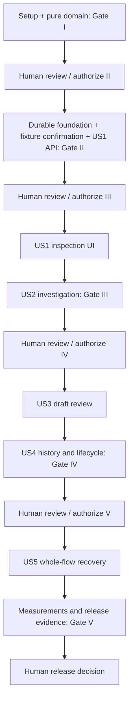

# Tasks: PromiseKeeper MVP Release 0.1

**Input**: Design documents in `specs/001-payment-case-mvp/`.
**Created**: 2026-10-23
**Feature context**: `001-payment-case-mvp`; no Git branch is created by this command.
**Prerequisites**: [spec.md](spec.md), [plan.md](plan.md), [research.md](research.md), [data-model.md](data-model.md), [API/tool contracts](contracts/api.md), [Investigator schema](contracts/investigator-output.schema.json), [UI contract](contracts/ui.md), and [quickstart.md](quickstart.md).
**Status**: Gate I (T001–T020) is complete and was reviewed and approved by the owner on 24 October 2026; see [the Gate I report](../../reports/phase-i.md). Task markers record executed work only. Gates II–V and release acceptance remain unauthorized/unexecuted.
**Tests**: Required by the feature's acceptance criteria and constitution X. Write the targeted contract/domain/component tests before their implementation, then record actual outcomes. For new behavior, establish a meaningful functional failure first; a missing tool/import is not acceptance evidence. Existing cross-flow regressions may already pass and must not be deliberately broken.
**Organization**: Task phases group work by story; implementation Gates I–V preserve the approved plan's separate human reviews. Shared mechanisms belong in foundations or the earliest story; later stories reuse them.
**Scope**: US1–US5 are P0-essential. US6/AC-28/FR-024 are deferred P1 with zero active tasks. A read-only US1 demonstration is an early increment, not the completed Release 0.1 MVP.

## Format and Path Conventions

Every task is `- [ ] T### [P?] [US#?] description` with exact repository-relative target paths, explicit prerequisite task IDs, a human authorization gate, and requirement references. Paths describe future files; they need not exist before implementation. Backend package paths use `backend/src/promisekeeper/`, frontend paths use `frontend/src/`, and reports use `reports/`.

- `[P]` denotes work on separate files that may proceed together **only after every listed dependency is complete and its gate is authorized**. It does not authorize bypassing a human gate or introducing application subagents.
- Story phases use `[US1]`–`[US5]`; setup, foundations, and final release tasks have no story label.
- Read constraints quoted in task descriptions literally and retain the complete fields/invariants in data-model.md and contracts/. Raw invalid fictional evidence is retained for review, not coerced into valid financial facts.
- This task-generation command does not evaluate or change [the reviewer-owned safety checklist](checklists/safety.md). Its 38 unchecked items require reviewer handling under the implementation workflow; checklist creation or task generation does not constitute phase approval.

## Implementation Authorization Gates

**Designated human reviewer**: the requesting project owner. No gate has been authorized by generating this file. Before Gate I, present its concrete scope and obtain explicit approval. At each phase exit, prepare the report with actual commands/results, unresolved/unexecuted checks, constitution compliance, and the proposed next scope; stop for human review. A completed report task is not authorization for the next gate. Record a human decision only when actually received.

| Gate from plan.md | Task range | Scope and exit record |
| --- | --- | --- |
| I | T001–T020 | Setup and pure domain/fixtures; `reports/phase-i.md`; stop before persistence work. |
| II | T021–T038 | Durable foundation, case-bound fixture preview/confirmation API, persisted-copy discovery and US1 minimal case API; `reports/phase-ii.md`; stop before frontend/agent integration. |
| III | T039–T061 | US1 inspection UI and US2 single-Investigator flow; `reports/phase-iii.md`; live extraction evidence required, then stop. |
| IV | T062–T084 | US3 drafts/reviews and US4 history/closure; `reports/phase-iv.md`; stop before release acceptance. |
| V | T085–T100 | US5 whole-flow recovery evidence plus all release measurements; `reports/phase-v.md` and `reports/release-acceptance.md`; stop for owner decision. |

Gate I precedes Gate II even though both contribute to the foundational task phase. US1 crosses Gates II/III: its API is reviewed before UI implementation begins. Foundation recovery is implemented/tested in Gate II, pipeline failure handling in Gate III, and draft recovery in Gate IV; US5/Gate V adds full-system fault proof rather than deferring those mechanisms.

## Phase 1: Setup (Shared Infrastructure)

**Gate**: I. **Goal**: Prepare the bounded local project and isolated verification tools.

**Independent exit criterion**: Backend/UI tools resolve with recorded versions; fixture tests use isolated storage and blocked external networking.

- [x] T001 Create the planned backend/frontend/test/report directories, ignore .runtime caches, virtual environments, credentials and build output, and document local-only fictional scope; repository initialization is separately authorized by the owner's current setup request. Target: `.gitignore`, `README.md`, `backend/.python-version`. Depends on: none; explicit Gate I authorization required. [Gate I; NFR-006, NFR-008]
- [x] T002 [P] Configure Python 3.12 packaging, FastAPI/Uvicorn, strict Pydantic 2, OpenAI SDK, tzdata and pytest dependencies; resolve tested versions into the lockfile and direct uv cache/interpreter storage into .runtime. Target: `backend/pyproject.toml`, `backend/uv.lock`. Depends on: T001. [Gate I; ADR-001]
- [x] T003 [P] Configure Node 24 React/TypeScript/Vite tooling, Vitest/Playwright, and scripts typecheck, test:unit, build and test:e2e using npm.cmd; resolve the actual package lock. Target: `frontend/package.json`, `frontend/package-lock.json`. Depends on: T001. [Gate I; ADR-001]
- [x] T004 [P] Provide temporary-database fixtures, fake business/execution clocks, subprocess helpers and external-network blocking; isolate all fictional test data from saved demonstrations. Target: `backend/tests/conftest.py`. Depends on: T002. [Gate I; AC-27, NFR-006]
- [x] T005 [P] Configure typechecking, component tests, loopback development proxy and Playwright's real API/temporary-database lifecycle; keep the browser cache inside .runtime. Target: `frontend/tsconfig.json`, `frontend/vite.config.ts`, `frontend/vitest.config.ts`, `tests/e2e/playwright.config.ts`. Depends on: T003. [Gate I; NFR-005, NFR-006]
- [x] T006 [P] Implement validated backend-only PK_* settings and redacted structured diagnostics, including STUB/LIVE labels, absolute workspace runtime paths, no secret echo and no silent model substitution. Target: `backend/src/promisekeeper/config.py`, `backend/src/promisekeeper/diagnostics.py`. Depends on: T002. [Gate I; NFR-006, NFR-007]

## Phase 2: Foundational (Blocking Prerequisites)

**Gate**: I. **Goal**: Establish pure domain rules, then durable shared boundaries, before user-story integration.

**Independent exit criterion**: Financial/date outcomes are testable without a model or database; transaction/recovery contracts use actual temporary SQLite.

- [x] T007 Write strict evidence/identity/value contract tests that retain raw invalid source values and distinguish authority from verification instead of coercing them; enforce immutable copy/source-version/catalogue commitment keys independent of candidate IDs/quote offsets and reject cross-copy/version attribution. Target: `backend/tests/contract/test_evidence_values.py`. Depends on: T004. [Gate I; AC-02, AC-03, AC-23]
- [x] T008 Implement UUID/copy-scoped identities and pure invoice/payment/evidence/CommitmentAnchor values with immutable catalogue keys and source-version clause ranges; preserve the constraints "event_at nullable", "supersedes_version_id nullable", "availability AVAILABLE/UNAVAILABLE/MISSING/UNREADABLE", "verification_status VERIFIED/UNVERIFIED/UNKNOWN", and "allocation_invoice_id nullable" verbatim from data-model.md. Enforce "Source IDs are unique within each demonstration copy; foreign keys validate copy ownership." and "Immutable. Corrections, reversals, explicit links and changed availability append versions and increment evidence_revision." Target: `backend/src/promisekeeper/domain/evidence.py`, `backend/src/promisekeeper/contracts/evidence.py`. Depends on: T007. [Gate I; FR-002, FR-007]
- [x] T009 [P] Write exact-paise tests for missing, negative, excessive precision and cross-currency source values, independently known balances and negative derived overpayment; no float or silent rounding. Target: `backend/tests/domain/test_money.py`. Depends on: T008. [Gate I; AC-21, AC-23, FV-02, FV-07]
- [x] T010 [P] Write source-time and deadline tests for date-only next-day midnight, offsets, relative dates without original timestamps, explicit supersession, reference versus real clocks with backward-reference-clock rejection, and earliest future WAIT boundary in both FV-18 date orderings; check before/at equality, subsequent WAIT and excluded fulfilled/superseded promises. Target: `backend/tests/domain/test_dates.py`. Depends on: T008. [Gate I; AC-05, AC-23, FV-04, FV-08, FV-18]
- [x] T011 Implement exact source-money parsing and integer-paise arithmetic with JSON/SQLite decimal strings matching "^-?(0|[1-9][0-9]*)$"; enforce "Payments/invoices require nonnegative valid amounts with at most two decimals." Preserve unknown/invalid originals. Target: `backend/src/promisekeeper/domain/money.py`. Depends on: T009. [Gate I; FR-007, AC-21, AC-23]
- [x] T012 Implement aware UTC/source-time values, Asia/Kolkata exclusive next-day expiry, supported deterministic source-date parsing and explicit unknown reasons; preserve "Unknown event times remain null." Keep business time separate from execution deadlines. Target: `backend/src/promisekeeper/domain/dates.py`. Depends on: T010. [Gate I; FR-005, FR-007, FR-009]
- [x] T013 Create only the three specified baseline cases and exact PK-001-U1/PK-002-U1/PK-003-U1 updates, with stable sources, immutable catalogue commitment keys/nonoverlapping clause anchors, exact anchored attribution/replacement links, explicit verification/completeness and catalogue-controlled clock events. Target: `backend/src/promisekeeper/fixtures/baseline.json`, `backend/src/promisekeeper/fixtures/catalogue.py`. Depends on: T008, T011, T012. [Gate I; FR-001, FR-022, AC-27]
- [x] T014 [P] Encode every branch of FV-01–FV-08 and FV-14–FV-16 and FV-18 as approved fresh-copy financial fixtures with their exact expected balances/actions and declared anchored links/registered clock events; include both FV-18 date orderings and their 25/27 October midnight outcomes; do not mutate baseline files. Target: `backend/src/promisekeeper/fixtures/financial_variants.json`. Depends on: T013. [Gate I; FV-01, FV-02, FV-03, FV-04, FV-05, FV-06, FV-07, FV-08, FV-14, FV-15, FV-16, FV-18]
- [x] T015 [P] Encode all FV-09–FV-13 and FV-17 workflow/failure/adversarial presets and expected outcomes, including each failed-rerun branch, without arbitrary ingestion or secret-bearing fixtures. Target: `backend/src/promisekeeper/fixtures/workflow_variants.json`. Depends on: T013. [Gate I; FV-09, FV-10, FV-11, FV-12, FV-13, FV-17]
- [x] T016 Write table-driven pure fixture/decision tests covering every baseline/update/financial variant, claim conflicts, duplicate/reversed allocations, unknowns, explicit promise links and the four-action precedence; assert FV-16 identity/credit invariance under both valid quote boundaries and FV-18 earliest/repeated-WAIT/exact-boundary outcomes. Target: `backend/tests/domain/test_reconciliation.py`, `backend/tests/domain/test_recommendations.py`, `backend/tests/contract/test_catalogue.py`. Depends on: T014, T015, T011, T012. [Gate I; AC-04, AC-05, AC-06, AC-07, AC-08, AC-09, AC-21, AC-22, AC-23, AC-26, AC-27, FV-16, FV-18]
- [x] T017 Implement deterministic eligible allocations, duplicate/conflict/reversal handling and known/unknown remainder; enforce "Eligibility requires verification_status=VERIFIED separately from authority designation, all verification fields, valid amount, same invoice/currency, settled/non-reversed state and availability." Never infer zero from unavailable lookup. Apply "Designated authority only. Unsuperseded conflicts make required facts unknown." to invoice projection. Target: `backend/src/promisekeeper/domain/payments.py`. Depends on: T016. [Gate I; FR-006, FR-007, AC-03, AC-21, AC-23]
- [x] T018 Implement immutable copy/source-version/catalogue commitment identity and unique-clause binding, quote offsets/candidate IDs excluded from identity, no silent link transfer to new source versions, unresolved null/ambiguous binding and rejected foreign keys, explicit replacement and claim reconciliation, plus promise credit separate from invoice allocation; enforce "Approved catalogue uses a whole payment attributed to at most one commitment. Conflicting/excessive links require review." Unknown promised amount cannot be fulfilled; FV-16 must retain INR 30,000 balance in both branches and identical linked identity/action across quote variations. Target: `backend/src/promisekeeper/domain/commitments.py`. Depends on: T017, T012. [Gate I; FR-004, FR-006, FR-007, FV-16]
- [x] T019 Implement VERIFY_PAYMENT > CLOSE > WAIT > FOLLOW_UP precedence with deterministic reason/source references, WAIT review_at as the earliest future invoice boundary or active/unfulfilled promise expiry justifying waiting, and fulfilled-partial-promise handling; at equality require review and allow WAIT again after reinvestigation; preserve "INCOMPLETE has no action." No model determines action or balance. Target: `backend/src/promisekeeper/domain/recommendations.py`. Depends on: T018, T017. [Gate I; FR-008, FR-009, AC-04, AC-05, AC-06, AC-07, AC-09, FV-18]
- [x] T020 Run pure/contract fixture checks, record actual commands, outcomes, versions, unresolved issues and constitution compliance; prepare Gate I review and STOP for project-owner authorization of Gate II. Target: `reports/phase-i.md`. Depends on: T019, T006, T005. [Gate I; Constitution-II, Constitution-X, Constitution-XV]

**Human checkpoint**: Stop here. The next implementation gate requires a new explicit project-owner authorization; passing checks or remaining unchecked tasks do not grant it.

## Phase 2 continued: Durable Foundation

**Gate**: II. **Goal**: Provide persistence, receipts, ownership, immutable snapshots and safe command plumbing.

**Independent exit criterion**: A real temporary SQLite file proves commit/replay, cross-case capacity, snapshot, restart, and exact case-bound fixture preview/confirmation invariants; no model is required. Staged Gate III/IV tests reuse this API before the update UI exists.

- [x] T021 [P] Write migration/foreign-key/immutable-history/receipt tests, same-ID replay versus changed-payload conflict, failed commits and selected-copy deletion tombstones. Target: `backend/tests/integration/test_sqlite_invariants.py`. Depends on: T020. [Gate II; AC-16, AC-25]
- [x] T022 [P] Write concurrent same-/different-case start tests, receipt-before-capacity replay, slot rollback, snapshot freshness and restart recovery with invalidated approval retained; use a scripted worker port. Target: `backend/tests/integration/test_attempt_transactions.py`. Depends on: T020. [Gate II; AC-13, AC-17, AC-18, AC-24, AC-25]
- [x] T023 Implement sole-process nonblocking Windows ownership before recovery, per-operation parameterized connections, explicit transactions and migrations with foreign_keys=ON, journal_mode=DELETE, synchronous=EXTRA and 250ms busy timeout. Target: `backend/src/promisekeeper/persistence/sqlite.py`, `backend/src/promisekeeper/persistence/ownership.py`. Depends on: T021, T022. [Gate II; ADR-004, AC-25]
- [x] T024 Create copy/case/evidence/projection/CommitmentAnchor/attribution tables with ownership foreign keys and immutable versions; enforce unique (demonstration_id, evidence_version_id, commitment_key), assign anchors once and reference exact anchor IDs in attribution; enforce "clock_mode REFERENCE/REAL", "lifecycle OPEN/CLOSED", "current_draft_version_id nullable" and "Monotonic revisions." Carry evidence nullability and verification constraints from T008 unchanged. Enforce "Only approved catalogue variants/events; no arbitrary evidence/time input." and "Monotonic revisions. Latest completed is not necessarily current; draft head changes atomically." Target: `backend/src/promisekeeper/persistence/migrations/001_evidence.sql`. Depends on: T023, T008, T018. [Gate II; FR-001, FR-002, FR-017]
- [x] T025 Create snapshot, attempt/result, step, draft/review, disposition, event and receipt tables: quote/enforce "retry_of nullable", "status RUNNING/COMPLETE/LIMITED/INCOMPLETE", "review_at nullable", "parent_version_id nullable", "expected_draft_head nullable", "status RUNNING/READY/FAILED", "invocation_kind INITIAL/AUTO_RETRY/MANUAL_RETRY", "APPROVE/REJECT", "ACCEPT/REJECT" and "optional reason"; add per-case RUNNING and per-step AUTO_RETRY uniqueness plus append-only event ordering. Enforce "Partial unique index: one RUNNING per case. Terminal attempts cannot accept late output. INCOMPLETE has no action." and "Unique investigation/step/invocation. At most one AUTO_RETRY per investigation/step across all executions; manual retry never resets that usage. Extraction has only INITIAL and optional AUTO_RETRY." Preserve "Append-only arrival/start/end/review/invalidation/decision/closure/reopening/failure history." Target: `backend/src/promisekeeper/persistence/migrations/002_workflow.sql`. Depends on: T024. [Gate II; FR-013, FR-014, FR-016, FR-017, FR-021]
- [x] T026 Implement copy-scoped immutable evidence/snapshot/history repositories, optimistic revisions and atomic command receipts; preserve "Unique durable ID; same request replays, different request conflicts. Content-free deletion receipt survives deletion." Preserve missing/unavailable/completeness observations in snapshots. Enforce "Immutable packet, including missing/unavailable states. A closed SQL transaction's snapshot alone is insufficient." Target: `backend/src/promisekeeper/persistence/repositories.py`, `backend/src/promisekeeper/application/operations.py`. Depends on: T025. [Gate II; FR-017, FR-019, FR-021, AC-25]
- [x] T027 Implement receipt lookup before busy rejection, global slot reservation before persisted start, OPEN/revision checks and atomic snapshot/RUNNING/review_epoch/invalidation/receipt writes; release slot on rollback/replay/terminal outcome and never hold a transaction across provider work. Target: `backend/src/promisekeeper/application/start_investigation.py`, `backend/src/promisekeeper/orchestration/capacity.py`. Depends on: T026, T022. [Gate II; FR-003, FR-014, FR-019, FR-021]
- [x] T028 Implement ownership-gated startup recovery: old RUNNING investigations become INCOMPLETE, running draft attempts become FAILED, committed results/epochs/counts survive, and late writes are fenced. Preserve "At most one AUTO_RETRY per investigation/step across all executions; manual retry never resets that usage." No reseeding or silent replay. Target: `backend/src/promisekeeper/persistence/recovery.py`. Depends on: T027. [Gate II; FR-017, FR-020, FR-021, AC-25]
- [x] T029 Implement strict version-1 command/error/receipt envelopes, /health and /operations/{operation_id}, readiness after recovery, safe exceptions, loopback Host/Origin and JSON/custom-header enforcement; preserve "operation_id:Id|null" in errors and reject unknown/coerced request fields. Target: `backend/src/promisekeeper/contracts/common.py`, `backend/src/promisekeeper/api/app.py`, `backend/src/promisekeeper/api/operations.py`. Depends on: T028, T006. [Gate II; NFR-006, NFR-007, AC-25]
- [x] T030 Implement init-demo/serve CLI commands with registered catalogue/REFERENCE-or-REAL modes, isolated new-copy creation, one-worker ownership-safe startup and built-UI static serving; never reset an existing copy on init/restart. Target: `backend/src/promisekeeper/cli.py`. Depends on: T029, T013. [Gate II; FR-001, FR-022, AC-27]
- [x] T031 [P] Write real-API/SQLite fixture preview/confirmation contract and transaction tests: read-only preview, exact copy/case/event/version/revision/hash, wrong target/hash and stale revision rejection, replay before revision checks, atomic arrival/invalidation and unchanged pre-update snapshots after mid-run arrival; reject arbitrary records. Target: `backend/tests/contract/test_scenario_events_api.py`, `backend/tests/integration/test_scenario_updates.py`. Depends on: T030, T022. [Gate II; FR-018, FR-019, AC-13, AC-17, AC-25, AC-27]
- [x] T032 Implement shared read-only case/event previews and confirmed catalogue update commands binding exact target/version/revision/evidence/clock changes into the hash; atomically append immutable evidence/anchors, invalidate freshness/approval, record confirmation/arrival/receipt and preserve closed/review-required status. Replay receipts before revision/hash checks; add no arbitrary evidence input. Target: `backend/src/promisekeeper/application/scenario_updates.py`. Depends on: T031, T026, T013. [Gate II; FR-018, FR-019, AC-13, AC-17, AC-25, AC-27]
- [x] T033 Implement strict preview/confirmation DTOs and GET /cases/{id}/scenario-events/{event_id}/preview plus POST /cases/{id}/scenario-events using the shared service/common envelopes; enforce copy ownership and safe PREVIEW_CHANGED/REVISION_CONFLICT responses. This API precedes the later fixture-update UI. Target: `backend/src/promisekeeper/contracts/scenarios.py`, `backend/src/promisekeeper/api/scenarios.py`. Depends on: T032, T029. [Gate II; FR-018, AC-17, AC-25, AC-27]

## Phase 3: User Story 1 — Understand a Payment Case (P0; first usable demonstration)

**Gate**: II then III. **Goal**: Open exactly three fictional cases and inspect invoice, ledger verification, raw claims and sources without investigating.

**Independent exit criterion**: AC-01–AC-03: inspect all starting cases directly, distinguish claims from verified settlement, and identify missing/unavailable evidence; provider access is unnecessary.

### Gate II: Read contracts, models, queries and minimal API

- [x] T034 [P] [US1] Write persisted-copy list/create/case/source contract tests for zero/one/multiple nondeleted summaries, deterministic ordering, persistence after restart, no listing-time seeding/reset, exact three cases per copy, raw originals, verification status and unavailable evidence, rejecting foreign-copy references and unapproved catalogue input. Target: `backend/tests/contract/test_cases_api.py`. Depends on: T030. [Gate II; AC-01, AC-02, AC-03, AC-16, AC-27]
- [x] T035 [US1] Implement strict DemonstrationSummary/list and case/evidence view contracts, including "variant_id:string or null", "selected_variant_id:string|null", "clock_mode REFERENCE/REAL", and "current_draft_version_id or null"; preserve all enum/nullability constraints in data-model.md rather than inferring facts in the browser. Target: `backend/src/promisekeeper/contracts/cases.py`. Depends on: T034. [Gate II; FR-001, FR-002]
- [x] T036 [US1] Implement read-only persisted nondeleted-copy listing ordered by created_at/id, explicit copy creation and case/source queries with raw originals, known/unknown amounts, payment verification, no false zero ledger and direct saved-state access; distinguish latest completed from current results through server-derived freshness. Target: `backend/src/promisekeeper/application/cases.py`. Depends on: T035, T026. [Gate II; FR-001, FR-002, FR-018, FR-023]
- [x] T037 [US1] Expose catalogue, GET /demonstrations, POST /demonstrations, selected-copy case listing, case detail and immutable evidence-version reads with strict validation and copy ownership; reuse common readiness/errors/receipts without adding ingestion or payment-edit endpoints. Target: `backend/src/promisekeeper/api/cases.py`, `backend/src/promisekeeper/api/demonstrations.py`. Depends on: T036. [Gate II; AC-01, AC-02, AC-03, NFR-006]
- [x] T038 [US1] Run durable foundation, copy-discovery, minimal case API and shared fixture preview/confirmation checks including commit failure, startup ownership, immutable anchors/snapshots, stale/wrong-target/hash rejection and receipt replay; record actual outcomes and STOP for project-owner authorization of Gate III. Target: `reports/phase-ii.md`. Depends on: T037, T033, T021, T022. [Gate II; Constitution-IX, Constitution-XV]

**Human checkpoint**: Stop here. The next implementation gate requires a new explicit project-owner authorization; passing checks or remaining unchecked tasks do not grant it.

### Gate III: Read-only UI and independent journey

- [ ] T039 [P] [US1] Write demonstration-selection/case/evidence/source-view component tests for valid saved selection, zero/one/multiple copies, missing/deleted selection, listing failure without implicit creation/reset, fictional labels, claims versus verified payments, unknowns and keyboard/non-color access without an investigation. Target: `frontend/tests/cases.test.tsx`. Depends on: T038, T005. [Gate III; AC-01, AC-02, AC-03, NFR-005]
- [ ] T040 [US1] Implement typed common API access, strict state/error mapping and a reusable stable-operation-ID interface; financial/eligibility values come from the server, not browser recalculation. Target: `frontend/src/api/client.ts`, `frontend/src/api/types.ts`. Depends on: T039, T035. [Gate III; FR-002, NFR-007]
- [ ] T041 [P] [US1] Implement direct case selection with exactly three fictional summaries, due date/currency/lifecycle and previous-investigation indicators. Target: `frontend/src/cases/CaseList.tsx`. Depends on: T040. [Gate III; AC-01]
- [ ] T042 [P] [US1] Implement raw invoice/message/ledger inspection, explicit verification/availability labels and exact-version source access without model execution. Target: `frontend/src/cases/CaseEvidence.tsx`, `frontend/src/cases/SourceViewer.tsx`. Depends on: T040. [Gate III; AC-02, AC-03]
- [ ] T043 [US1] Wire root discovery and persisted selected_demonstration_id: restore valid selection, otherwise select the sole copy, offer a chooser for several or explicit creation for none; preserve preference on listing failure and never retarget copy-scoped pending work. Integrate case list/detail, explicit STUB/LIVE and REFERENCE/REAL banners, responsive saved-state loading/errors, visible focus and 200% text support. Target: `frontend/src/App.tsx`, `frontend/src/cases/DemonstrationPicker.tsx`, `frontend/src/api/demonstrationSelection.ts`, `frontend/src/components/StatusBanner.tsx`, `frontend/src/styles.css`. Depends on: T041, T042. [Gate III; FR-001, AC-01, AC-16, FR-023, NFR-005, NFR-006, NFR-007]
- [ ] T044 [US1] Run the first independent read-only case journey against the real local API and temporary database, including zero/one/multiple-copy selection, reload/backend-restart resume, missing selection and recoverable listing failure without implicit creation/reset; record AC-01–AC-03 evidence and preserved three-case scope without claiming full MVP acceptance. Target: `tests/e2e/case-review.spec.ts`, `reports/us1-case-review.md`. Depends on: T043, T037. [Gate III; AC-01, AC-02, AC-03, AC-16, AC-27]

## Phase 4: User Story 2 — Investigate and Choose a Responsible Next Action (P0)

**Gate**: III. **Goal**: Extract evidence-backed candidates with exactly one Investigator and display one deterministic supported recommendation.

**Independent exit criterion**: AC-04–AC-09: baseline FOLLOW_UP/WAIT/VERIFY_PAYMENT plus staged CLOSE, traceable sources, exact review time and no guessed facts; assess FV-16 in both branches.

### Required tests before targeted implementation

- [ ] T045 [P] [US2] Write output-schema, required nullable commitment_key, unknown/null, extra-authority-field, duplicate-candidate, foreign-source/key, exact span and packet-bound tests; verify both FV-16 quotes bind the same anchor, ambiguous binding stays unresolved, and include refusal/malformed/injection cases and do not accept empty fabricated success. Target: `backend/tests/contract/test_investigator.py`. Depends on: T044. [Gate III; AC-08, AC-21, AC-26, FV-12, FV-16]
- [ ] T046 [P] [US2] Write real-persistence start/status/result contract and integration tests using a scripted Investigator, including explicitly previewed/confirmed evidence arriving mid-run through the Gate II API, stable promise links across quote variants, late completion, missing records and single-slot busy/replay behavior. Target: `backend/tests/contract/test_investigations_api.py`, `backend/tests/integration/test_investigation_pipeline.py`. Depends on: T044, T033. [Gate III; AC-04, AC-05, AC-06, AC-07, AC-09, AC-17, AC-24, AC-25]
- [ ] T047 [P] [US2] Write running/limited/incomplete/stale-result/action/timeline component tests with stable source links, explicit undated group and old completed result retained during a failed rerun. Target: `frontend/tests/investigations.test.tsx`. Depends on: T044. [Gate III; AC-08, AC-09, AC-18, AC-24, NFR-007]
### Models, services, integration and acceptance evidence

- [ ] T048 [US2] Implement the single Investigator protocol, strict candidate/result/snapshot contracts from the supplied JSON schema, and required nullable commitment_key/validated catalogue-anchor references independent of candidate IDs/spans; enforce "review_at nullable", "COMPLETE/LIMITED has one allowed action." and allowed actions without letting the agent supply balances, deadline instants or permissions. Target: `backend/src/promisekeeper/agents/protocol.py`, `backend/src/promisekeeper/contracts/investigations.py`. Depends on: T045, T046. [Gate III; FR-003, FR-004, FR-008, FR-010]
- [ ] T049 [US2] Implement only bounded immutable snapshot lookup including approved source-version commitment keys/clause ranges in the integrity hash, conveying no extracted amount/date/verification facts; enforce "64 records, each at most 8000 Unicode code points, total at most 64000" and reject foreign IDs/paths/URLs or oversized packets visibly without truncation. Target: `backend/src/promisekeeper/tools/evidence.py`. Depends on: T048, T026. [Gate III; FR-010, FR-019, AC-26]
- [ ] T050 [US2] Implement strict output and semantic validation: "0 <= start < end <= source length", source[start:end] equals quote with Unicode code-point offsets, all tokens/supersession references supported, unknowns remain null, and no model output promotes verification. Delegate binding to pure catalogue-anchor rules: matching source/key, exactly one intersected clause, amount/currency/date tokens supported within clause/quote, null/ambiguous binding unresolved and unknown/foreign provided keys invalid; speaker identity may use original author metadata. Never hash quote offsets into identity. Target: `backend/src/promisekeeper/agents/validation.py`. Depends on: T049, T045, T018. [Gate III; FR-004, FR-007, FR-010, AC-08, AC-26, FV-16]
- [ ] T051 [US2] Implement an explicitly STUB-labeled adapter returning approved fixture candidate packets and bounded named refusal/malformed/timeout behaviors, while preserving the same runtime validation and deterministic domain path. Target: `backend/src/promisekeeper/agents/scripted.py`. Depends on: T050, T015. [Gate III; AC-24, AC-26, AC-27, NFR-007]
- [ ] T052 [US2] Implement the sole LIVE Responses/Structured Outputs adapter with backend-only credentials, requested/returned model and response/prompt/schema/adapter versions, max_retries=0, 20-second call deadline and configured gpt-5.6-terra candidate; refusal/invalid output fails safely with no repair loop or autonomous tools. Target: `backend/src/promisekeeper/agents/openai.py`. Depends on: T050, T006. [Gate III; AC-08, AC-24, AC-26, ADR-002]
- [ ] T053 [US2] Implement immutable-snapshot extraction -> validation -> deterministic reconciliation/action -> COMPLETE/LIMITED persistence, preserving original evaluation time, latest completed history and explicit missing extraction; draft failure must not erase the saved recommendation. Target: `backend/src/promisekeeper/orchestration/investigate.py`. Depends on: T051, T052, T019, T027. [Gate III; FR-003, FR-006, FR-008, FR-019, FR-020]
- [ ] T054 [US2] Implement persisted step invocations, one transient automatic retry per investigation/step, 55-second overall budget, terminal-state fencing and capacity release; distinguish "invocation_kind INITIAL/AUTO_RETRY/MANUAL_RETRY" without resetting counts on restart. Target: `backend/src/promisekeeper/orchestration/deadlines.py`, `backend/src/promisekeeper/orchestration/retries.py`. Depends on: T053, T028. [Gate III; FR-021, AC-24, AC-25]
- [ ] T055 [US2] Implement deterministic explanations, financial certainty/contested labels, source-linked material reasons and event-time/source-ID timeline ordering with separate arrival and undated evidence; freshness remains server-derived. Target: `backend/src/promisekeeper/application/findings.py`. Depends on: T054, T036. [Gate III; FR-005, FR-006, FR-010, AC-08, FV-15]
- [ ] T056 [US2] Wire POST investigation/GET attempt and result views to durable start/worker execution and strict CaseView freshness; acknowledgement follows committed start, never generation completion; preserve null action for INCOMPLETE. Target: `backend/src/promisekeeper/api/investigations.py`. Depends on: T055. [Gate III; FR-003, AC-09, AC-24]
- [ ] T057 [US2] Implement explicit start, safe acknowledgement/polling, previous-result visibility, bounded waiting and retry actions with stable operation IDs; show connectivity limitation by 60 seconds and never label unsaved work successful. Target: `frontend/src/investigations/InvestigationControls.tsx`. Depends on: T056, T047, T040. [Gate III; AC-09, AC-18, AC-24, AC-25, NFR-002]
- [ ] T058 [US2] Implement one action, concrete next step, applicable due/promise dates and earliest future WAIT review boundary with review-required at equality, source-linked findings/commitments, explicit attribution/fulfillment and chronological evidence; VERIFY_PAYMENT shows no demand and CLOSE does not close automatically. Target: `frontend/src/investigations/FindingsView.tsx`, `frontend/src/investigations/Timeline.tsx`. Depends on: T056, T047. [Gate III; AC-04, AC-05, AC-06, AC-07, AC-08, AC-09, FV-16, FV-18]
- [ ] T059 [US2] Run baseline/staged four-action and all financial-variant journeys with the real API and scripted adapter; use a helper that fetches the Gate II case/event preview and submits its exact revision/version/hash as simulated owner confirmation, independent of the later update UI; assert exact balances, expiry, source links, unknowns and both FV-16 actions/quote-invariant identity and FV-18 first-boundary WAIT/second-boundary FOLLOW_UP without contact, with prior results retained. Target: `tests/e2e/investigation.spec.ts`, `tests/e2e/support/scenarioEvents.ts`, `reports/us2-investigation.md`. Depends on: T057, T058, T033. [Gate III; AC-04, AC-05, AC-06, AC-07, AC-08, AC-09, AC-21, AC-22, AC-23, FV-16, FV-18]
- [ ] T060 [US2] Implement the live candidate-evaluation runner and CLI evaluate --suite live --catalogue release-0.1 --repeats 3; record actual account access, model identity, extraction/source/uncertainty correctness and latency. Missing credentials or failed acceptance blocks Gate III; STUB cannot substitute. Target: `backend/tests/evaluations/test_live_extraction.py`, `backend/src/promisekeeper/application/evaluations.py`, `backend/src/promisekeeper/cli.py`, `reports/live-evaluation.json`. Depends on: T059. [Gate III; NFR-004, SC-004, Constitution-X]
- [ ] T061 [US2] Run story/domain/contracts/integration/component/e2e checks and review the actual live evaluation; record results, limitations and constitution compliance and STOP for project-owner authorization of Gate IV. Target: `reports/phase-iii.md`. Depends on: T060. [Gate III; Constitution-XV, Constitution-XVI]

**Human checkpoint**: Stop here. The next implementation gate requires a new explicit project-owner authorization; passing checks or remaining unchecked tasks do not grant it.

## Phase 5: User Story 3 — Review a Draft Under Human Control (P0)

**Gate**: IV. **Goal**: Review/edit/save/approve/reject exact supported draft versions without sending or changing financial facts.

**Independent exit criterion**: AC-10–AC-15: FOLLOW_UP and clarification drafts, neutral edits versus unsupported claims, exact review history and all FV-17 eligibility branches; no customer transmission.

### Required tests before targeted implementation

- [ ] T062 [P] [US3] Write supported-fact template/allowed-clause/eligibility tests for valid wording alternatives versus altered amount, fee, assertion, instruction or placeholder; define exact no-draft reasons for WAIT/CLOSE/internal verification. Target: `backend/tests/domain/test_drafts.py`. Depends on: T061. [Gate IV; AC-10, AC-11, AC-15, FV-11, FV-13]
- [ ] T063 [P] [US3] Write edit/review/draft-retry contract and transaction tests for exact hash/current head, newer edit invalidation, no running investigation, repeated operations and every FV-17 failed-rerun branch; include unsupported send routes/capability absence. Target: `backend/tests/contract/test_reviews_api.py`, `backend/tests/integration/test_review_transactions.py`. Depends on: T061. [Gate IV; AC-12, AC-13, AC-14, AC-15, AC-25, FV-10, FV-17]
- [ ] T064 [P] [US3] Write editor/review component tests for retained unsaved text, explicit decisions, exact recipient/version, blocked stale/unsupported drafts, truthful save errors and no Send action. Target: `frontend/tests/reviews.test.tsx`. Depends on: T061. [Gate IV; AC-12, AC-13, AC-14, AC-15, NFR-005, NFR-007]
### Models, services, integration and acceptance evidence

- [ ] T065 [US3] Implement DraftVersion/DraftReview/DraftGenerationAttempt strict contracts with "parent_version_id nullable", "expected_draft_head nullable", "status RUNNING/READY/FAILED", "APPROVE/REJECT", "exact_text:string (1–8000 chars)" and "No SENT state." Bind exact target/text/hash, origin, evidence_revision and review_epoch; recipients are catalogue fictional contacts. Enforce "Immutable edits. Every changed text/recipient creates an unapproved version; no financial authority." Target: `backend/src/promisekeeper/contracts/reviews.py`, `backend/src/promisekeeper/domain/review.py`. Depends on: T062, T063. [Gate IV; FR-012, FR-013, FR-014]
- [ ] T066 [US3] Implement deterministic evidence-backed FOLLOW_UP/neutral clarification templates and a conservative finite allowed-clause validator with safe wording alternatives; unrecognized financial clauses fail closed and unknown/placeholders cannot be approved. Target: `backend/src/promisekeeper/application/draft_templates.py`, `backend/src/promisekeeper/domain/draft_validation.py`. Depends on: T065. [Gate IV; FR-011, FR-012, AC-10, AC-11, AC-15, FV-11, FV-13]
- [ ] T067 [US3] Implement initial draft generation plus a separate durable manual draft-retry operation bound to the same current result/snapshot/expected head; preserve a saved recommendation and automatic retry usage, use a fresh at-most-55-second manual deadline, fence late/stale output, and never overwrite owner edits. Enforce "Independent of completed recommendation. Manual retry binds the failed step, original snapshot/result and expected head; it cannot overwrite an owner edit or superseding result." Target: `backend/src/promisekeeper/orchestration/drafts.py`, `backend/src/promisekeeper/application/draft_retry.py`. Depends on: T066, T026, T054. [Gate IV; FR-011, FR-017, FR-021, AC-24, AC-25]
- [ ] T068 [US3] Implement atomic edit/head/case_revision/review_epoch/invalidation and exact explicit approve/reject/receipt commands. A failed rerun never restores approval; fresh approval uses the current epoch only if the earlier current draft's result remains latest/current/eligible. Block old version, new evidence, newer result or running investigation. Enforce "Append-only. Current approval derives from version/epoch/eligibility. No SENT state." Target: `backend/src/promisekeeper/application/reviews.py`. Depends on: T067, T063. [Gate IV; FR-013, FR-014, FR-015, AC-12, AC-13, AC-14, FV-17]
- [ ] T069 [US3] Expose draft version creation, draft-retries, draft-attempt status and review commands with the specified 201/202/200 receipts, safe validation/conflict reasons and server-side eligibility; expose no sending endpoint or transport. Target: `backend/src/promisekeeper/api/reviews.py`. Depends on: T068. [Gate IV; AC-12, AC-13, AC-14, AC-15]
- [ ] T070 [US3] Persist pending operation ID/exact payload and unsaved draft text in the client scoped to their originating demonstration/case; switching selection cannot retarget them; reconcile uncertain outcomes through receipts before retry, reject changed-payload reuse, and never optimistically claim saved/approved state. Target: `frontend/src/api/pendingOperations.ts`, `frontend/src/reviews/useDraftReview.ts`. Depends on: T069, T040, T064. [Gate IV; AC-12, AC-25, NFR-007]
- [ ] T071 [US3] Implement accessible exact draft/recipient/version display, safe edit/save/approve/reject decisions, clause-specific corrections, review history, no-draft explanations and failed-draft-step retry; current head/epoch/eligibility comes from the server. Target: `frontend/src/reviews/DraftReview.tsx`. Depends on: T070, T066. [Gate IV; AC-10, AC-11, AC-12, AC-13, AC-14, AC-15]
- [ ] T072 [US3] Run review journeys including FV-10/FV-11/FV-13 and all FV-17 branches, changed-recipient/head conflicts, repeated submissions, copy switches with pending work and draft-step failure without losing recommendation; introduce updates through the existing preview/confirmation API helper before US4 UI work; record exact decisions and zero customer transmissions. Target: `tests/e2e/draft-review.spec.ts`, `reports/us3-draft-review.md`. Depends on: T071, T033, T059. [Gate IV; AC-10, AC-11, AC-12, AC-13, AC-14, AC-15, AC-25, FV-10, FV-11, FV-13, FV-17, SC-005]

## Phase 6: User Story 4 — Return and Reinvestigate Without Losing History (P0)

**Gate**: IV. **Goal**: Preserve decisions/evidence, confirm lifecycle changes, introduce reviewed fictional updates and reinvestigate without rewriting history.

**Independent exit criterion**: AC-16–AC-20: restart/reopen with identical history, staged PK-003 VERIFY_PAYMENT -> CLOSE with explicit owner confirmation, old investigations preserved, stale closure blocked.

### Required tests before targeted implementation

- [ ] T073 [P] [US4] Write history/disposition/closure/reopening/update/deletion contract and integration tests for current zero-balance CLOSE, exact confirmation hashes, no running attempt, changed evidence on closed cases and preserved prior outcomes. Target: `backend/tests/contract/test_case_lifecycle_api.py`, `backend/tests/integration/test_case_history.py`. Depends on: T072. [Gate IV; AC-16, AC-17, AC-18, AC-19, AC-20, AC-25]
- [ ] T074 [P] [US4] Write direct history/source inspection, recommendation disposition, fixture preview/confirmation and stale/eligible closure/reopening component tests with accessible controls. Target: `frontend/tests/history.test.tsx`. Depends on: T072. [Gate IV; AC-16, AC-17, AC-19, AC-20, NFR-005]
### Models, services, integration and acceptance evidence

- [ ] T075 [US4] Implement owner-disposition/lifecycle/event contracts with "ACCEPT/REJECT", "optional reason", "reason:string or null (max 1000 chars)", explicit confirm:true, exact result/update hashes and source references; advice disposition remains separate from draft approval and settlement. Enforce "Separate from finance, draft approval and closure." Target: `backend/src/promisekeeper/contracts/decisions.py`. Depends on: T073. [Gate IV; FR-016, AC-19, AC-20]
- [ ] T076 [US4] Implement ordered immutable event/investigation/review/source history with "limit integer 1–100 (default 50)", stable cursors, original evaluation time and accessible prior exact evidence versions; do not rewrite or silently prune history. Target: `backend/src/promisekeeper/application/history.py`. Depends on: T075, T026. [Gate IV; FR-017, FR-023, AC-16, AC-18]
- [ ] T077 [US4] Implement auditable dispositions plus transactional eligible explicit closure/reopening using latest completed/current result, exact zero/no conflict and no RUNNING attempt; accepting advice alone changes no lifecycle or verification. Target: `backend/src/promisekeeper/application/decisions.py`, `backend/src/promisekeeper/application/lifecycle.py`. Depends on: T076. [Gate IV; FR-016, AC-19, AC-20]
- [ ] T078 [US4] Integrate the existing Gate II preview/confirmation command with closure/reopening/history: prove confirmed evidence on CLOSED cases keeps them CLOSED/review-required, invalidates freshness/approval and preserves closure/result events until explicit reopening. Reuse the service/routes instead of recreating them here. Target: `backend/src/promisekeeper/application/scenario_updates.py`, `backend/tests/integration/test_closed_case_updates.py`. Depends on: T077, T033, T073. [Gate IV; FR-018, FR-019, AC-17, AC-19, AC-27]
- [ ] T079 [US4] Implement explicitly confirmed selected-copy deletion with a content-free operation tombstone, preserving every other copy and replay protection; do not add reset-on-start or delete-all. Target: `backend/src/promisekeeper/application/demonstrations.py`. Depends on: T078. [Gate IV; FR-017, AC-27, NFR-006]
- [ ] T080 [US4] Expose history, dispositions, closure, reopening and demonstration deletion contracts using strict errors/receipts and copy ownership; reuse the already available scenario-event routes and retain manual-authority/no-send boundaries. Target: `backend/src/promisekeeper/api/history.py`, `backend/src/promisekeeper/api/decisions.py`, `backend/src/promisekeeper/api/demonstrations.py`. Depends on: T079. [Gate IV; AC-16, AC-17, AC-19, AC-20]
- [ ] T081 [US4] Implement time-ordered history and direct prior investigation/draft/review/source inspection with original evaluation/arrival context and explicit current versus historical labels. Target: `frontend/src/history/CaseHistory.tsx`. Depends on: T080, T074. [Gate IV; AC-16, AC-18, FR-023]
- [ ] T082 [US4] Implement optional-reason advice decisions, eligible closure/reopening confirmation, exact fictional update preview/confirmation using the Gate II API, and selected-copy deletion that clears its local selection and refreshes discovery without affecting other copies/pending work; stale preview requires a fresh preview/confirmation; surface server blocking reasons and retain old result/closure context. Target: `frontend/src/history/OwnerDecisions.tsx`, `frontend/src/history/ScenarioUpdate.tsx`. Depends on: T081, T033, T043. [Gate IV; AC-17, AC-19, AC-20]
- [ ] T083 [US4] Run return/restart/reinvestigation journeys, staged PK-003 settlement/explicit closure, later conflicting evidence/reopening, rejected advice and saved draft reviews; assert unchanged historical snapshots, exact decisions and no duplicate lifecycle events. Target: `tests/e2e/history-lifecycle.spec.ts`, `reports/us4-history.md`. Depends on: T082. [Gate IV; AC-16, AC-17, AC-18, AC-19, AC-20, AC-25, SC-005, SC-006]
- [ ] T084 [US4] Run all US3/US4 checks and record actual exact-payload, FV-17, history, no-send and closure evidence, limitations and constitution compliance; STOP for project-owner authorization of Gate V. Target: `reports/phase-iv.md`. Depends on: T083. [Gate IV; Constitution-XV, Constitution-XVI]

**Human checkpoint**: Stop here. The next implementation gate requires a new explicit project-owner authorization; passing checks or remaining unchecked tasks do not grant it.

## Phase 7: User Story 5 — Recover Safely from Missing Evidence and Interrupted Work (P0)

**Gate**: V. **Goal**: Prove the already implemented bounded recovery paths across the whole UI/API/storage flow; do not defer foundational failure behavior or its tests to this phase.

**Independent exit criterion**: AC-21–AC-27: every named failure variant has its limited/incomplete outcome, precise recovery step, bounded retry/visibility and preserved history; unknown commits and process restarts do not duplicate decisions.

### Required tests before targeted implementation

- [ ] T085 [P] [US5] Write subprocess-level process-kill/restart and response-lost-after-commit journeys for start, result, draft, approval and closure; assert receipt reconciliation, preserved earlier state and no restored approval or duplicate decisions. Target: `tests/e2e/restart-recovery.spec.ts`. Depends on: T084. [Gate V; AC-16, AC-18, AC-24, AC-25, FV-09, FV-17]
- [ ] T086 [P] [US5] Write real-time UI/API forced-timeout/retry-exhaustion tests, including provider output after terminal fencing, unreachable-server limitation by 60 seconds and independent execution/business clocks; fake-time unit tests cannot substitute for this evidence. Target: `tests/e2e/deadline-recovery.spec.ts`. Depends on: T084. [Gate V; AC-24, AC-25, NFR-002, SC-008]
- [ ] T087 [P] [US5] Write full-workflow concurrent evidence/start/approve/close/edit tests and cross-case single-slot races against actual SQLite; distinguish transport repeats from manual recovery and reject stale payload/head/epoch writes. Target: `backend/tests/integration/test_workflow_races.py`. Depends on: T084. [Gate V; AC-13, AC-19, AC-25, FV-17]
- [ ] T088 [P] [US5] Add cross-flow redaction and untrusted-message/source-reference tests covering claims versus authority, designated-but-unverified ledger entries, refusal/malformed extraction and fictional-only inputs; assert secrets never enter user-visible diagnostics or evaluation reports. Target: `backend/tests/integration/test_information_boundaries.py`. Depends on: T084. [Gate V; AC-03, AC-26, NFR-006, NFR-007, FV-12]
### Models, services, integration and acceptance evidence

- [ ] T089 [US5] Integrate registered failure presets, controlled kill/commit-boundary triggers and temporary-copy isolation into the test/evaluation harness; hooks must be test-only, bounded and unavailable as arbitrary runtime write endpoints. Target: `backend/tests/support/fault_scenarios.py`, `tests/e2e/support/fixtures.ts`. Depends on: T085, T086, T087. [Gate V; AC-21, AC-24, AC-25, AC-27, FV-09]
- [ ] T090 [US5] Implement evaluate --suite fixtures and reproducible report collection for every baseline/update/FV branch using the actual domain/orchestration path and scripted adapter; report exact known/unknown money, actions, provenance, approval and failure outcomes without fabricating success. Target: `backend/src/promisekeeper/application/fixture_evaluation.py`, `backend/src/promisekeeper/cli.py`. Depends on: T089. [Gate V; FR-022, AC-09, AC-21, AC-22, AC-23, AC-24, AC-25, AC-26, AC-27, SC-004]
- [ ] T091 [US5] Run all US5 whole-flow failure/race/restart scenarios and every registered variant branch, documenting actual outcomes and unresolved issues; preserve pending unsaved edits and limited/incomplete distinctions across reopening. Target: `reports/us5-recovery.md`, `reports/fixture-evaluation.json`. Depends on: T090, T088. [Gate V; AC-21, AC-22, AC-23, AC-24, AC-25, AC-26, AC-27, NFR-004]

## Phase 8: User Story 6 — See What Changed Since the Prior Investigation (P1; deferred)

**Goal**: Future comparison summaries may identify new evidence and changed recommendations without rewriting either result.
**Independent test if later authorized**: AC-28 compares the two saved PK-003 investigations and links both originals.
**Current scope**: Zero active tasks. FR-024/AC-28 remain explicitly deferred under plan.md; do not build a comparison feature or optional chat during this MVP. Generate a separate bounded task set only after an explicit scope decision.

## Phase 9: Polish and Cross-Cutting Release Evidence

**Gate**: V. **Goal**: Measure complete-release accessibility, responsiveness, preservation, live extraction and owner outcomes, and prepare truthful final review evidence.

**Independent exit criterion**: All P0 ACs/FV branches/NFRs have recorded outcomes; every SC is measured or explicitly unexecuted/failed, with unmet learning targets disclosed. No release approval is inferred.

- [ ] T092 [P] Run keyboard/focus/non-color/status and 200% text enlargement checks across every P0 journey; combine meaningful automated checks with recorded manual readability observations. Target: `tests/e2e/accessibility.spec.ts`, `reports/accessibility.md`. Depends on: T091. [Gate V; NFR-005]
- [ ] T093 [P] Implement and run measure --suite responsiveness --trials-per-case 10 and measure --suite preservation --cycles 10 against declared LIVE conditions; record 29/30 thresholds for opens<=3s and acknowledgements<=2s, terminal outcomes<=60s, exact preservation and duplicate counts. Target: `backend/src/promisekeeper/application/measurements.py`, `backend/src/promisekeeper/cli.py`, `reports/responsiveness.json`, `reports/preservation.json`. Depends on: T091. [Gate V; NFR-002, NFR-003, SC-006, SC-008]
- [ ] T094 [P] Prepare five-owner evaluation instructions and blank observation forms using equivalent fictional manual-review copies and rotated order; define timing, correctness, evidence understanding and clarity/control rating collection without recruiting or messaging anyone automatically. Target: `reports/owner-evaluation-protocol.md`, `reports/owner-observations.csv`. Depends on: T091. [Gate V; NFR-001, SC-001, SC-002, SC-003, SC-007]
- [ ] T095 Collect actual project-owner-facilitated results from five representative agency owners: 4/5 independent first journeys within 5 minutes, source/claim understanding, manual-versus-assisted median improvement and clarity/control ratings; leave unavailable observations unexecuted and acceptance blocked rather than invent data. Target: `reports/owner-evaluation.md`. Depends on: T094. [Gate V; NFR-001, SC-001, SC-002, SC-003, SC-007]
- [ ] T096 [P] Reconcile Gate III live evaluation with final model/prompt/schema/adapter and fixture versions; rerun only affected live cases when changed, record every baseline/update/variant's expected financial/action/provenance outcomes, and keep STUB results separate. Target: `reports/live-evaluation.json`, `reports/live-evaluation-summary.md`. Depends on: T091, T060. [Gate V; NFR-004, SC-004]
- [ ] T097 Run the documented frozen setup/build/unit/contract/integration/e2e and local-serving flow in isolated runtime storage, including loopback/same-origin enforcement, no sending/ingestion endpoints, secret redaction, one worker and explicit fictional/mode disclosure; record actual environment and failures. Target: `reports/runtime-validation.md`. Depends on: T092, T093, T096. [Gate V; NFR-006, NFR-007, NFR-008, SC-005]
- [ ] T098 Build the final requirement-to-test/evidence matrix for FR-001–FR-023, AC-01–AC-27, all 18 FV groups, all NFRs/SCs and constitutional gates; mark FR-024/AC-28 deferred, preserve failed/skipped/unexecuted states and require 100% evidence/approval/history integrity. Target: `reports/acceptance-matrix.md`. Depends on: T097, T095. [Gate V; SC-004, SC-005, SC-006, SC-008]
- [ ] T099 Update actual setup/run/validation and phase-review instructions using executed commands and resolved versions, including separate draft retries, scoped deletion and restart behavior; retain fictional-only and no-send boundaries. Target: `README.md`, `specs/001-payment-case-mvp/quickstart.md`. Depends on: T098. [Gate V; FR-017, FR-021, NFR-006, NFR-007]
- [ ] T100 Present the final Gate V/release review with actual acceptance evidence, SC-002/SC-007 learning-target disclosure, unmet/unexecuted checks and constitution compliance against 26 October 2026 10:00 IST; STOP for explicit owner decision and never infer acceptance or waive P0 safety to meet cutoff. Target: `reports/phase-v.md`, `reports/release-acceptance.md`. Depends on: T099. [Gate V; Constitution-XIV, Constitution-XV, Constitution-XVI]

**Human checkpoint**: Stop here. The next implementation gate requires a new explicit project-owner authorization; passing checks or remaining unchecked tasks do not grant it.

## Requirement and Evidence Traceability

Shared task coverage is intentional: US5 recovery requirements are already enforced by foundational and earlier-story tasks, with full-system proof in Phase 7. A future task checkbox records completed work, never a manufactured evaluation result.

| Functional requirement | Owning tasks |
| --- | --- |
| FR-001 | T013, T030, T034, T036, T037, T041, T043, T044 |
| FR-002 | T008, T035, T036, T042 |
| FR-003 | T027, T053, T056, T057 |
| FR-004 | T018, T048, T050, T052 |
| FR-005 | T012, T055, T058 |
| FR-006 | T017, T018, T055 |
| FR-007 | T008, T011, T012, T017, T018 |
| FR-008 | T019, T053, T059 |
| FR-009 | T010, T012, T016, T019, T058, T059 |
| FR-010 | T049, T050, T055, T058 |
| FR-011 | T066, T067, T071 |
| FR-012 | T062, T065, T066 |
| FR-013 | T063, T068, T071, T072 |
| FR-014 | T027, T068, T072 |
| FR-015 | T063, T069, T071, T097 |
| FR-016 | T075, T077, T082, T083 |
| FR-017 | T026, T028, T076, T085, T093 |
| FR-018 | T036, T031, T032, T033, T078, T083 |
| FR-019 | T026, T027, T053, T031, T032, T078 |
| FR-020 | T017, T018, T053, T089 |
| FR-021 | T027, T028, T054, T067, T070, T087 |
| FR-022 | T013, T014, T015, T090 |
| FR-023 | T043, T058, T071, T081 |
| FR-024 | Deferred P1; zero active US6 tasks. |

| Acceptance / scenario set | Primary evidence tasks |
| --- | --- |
| AC-01–AC-03 | T034, T039, T044 |
| AC-04–AC-09 | T016, T046, T059, T060 |
| AC-10–AC-15 | T062, T063, T064, T072 |
| AC-16–AC-20 | T034, T044, T031, T073, T083, T085 |
| AC-21–AC-27 | T016, T059, T085, T086, T088, T091 |
| AC-28 | Deferred P1; no active task or MVP pass claim. |
| FV-01–FV-08, FV-14–FV-16, all branches | T014, T016, T059, T090 |
| FV-09 | T015, T085, T086, T089, T091 |
| FV-10, FV-11, FV-13 | T015, T072 |
| FV-12 | T015, T045, T050, T088 |
| FV-17, all branches | T015, T063, T072, T085, T087 |
| FV-18, both date orderings and clock events | T010, T014, T016, T059, T060, T090, T096 |

| Non-functional / outcome requirement | Evidence tasks |
| --- | --- |
| NFR-001; SC-001, SC-002, SC-003, SC-007 | T094, T095 |
| NFR-002; SC-008 | T086, T093 |
| NFR-003; SC-006 | T085, T093 |
| NFR-004; SC-004 | T059, T090, T096, T098 |
| NFR-005 | T039, T064, T074, T092 |
| NFR-006 | T001, T006, T029, T088, T097 |
| NFR-007 | T057, T070, T081, T088, T097 |
| NFR-008 | T001, T030, T097 |
| SC-005 | T072, T083, T097, T098 |

| Contract surface / entities | Owning tasks |
| --- | --- |
| Common envelope, health, operation receipts | T029, T026 |
| Demonstration discovery/selection, case/source catalogue and reads | T034, T035, T036, T037, T039, T043, T044 |
| Shared case-bound fixture preview/confirmation | T031, T032, T033 |
| Read-only snapshot, Investigator output schema and result/start/status | T045, T048, T049, T050, T056 |
| Draft generation/retry/version/review | T063, T065, T067, T068, T069 |
| History, disposition, closure/reopening, closed-case update integration and deletion | T073, T075, T076, T077, T078, T079, T080 |
| Shared evidence/payment/commitment values, immutable anchors and projections | T007, T008, T013, T017, T018, T024 |
| Snapshot/attempt/step/result/draft/review/event/receipt persistence | T025, T026, T028 |
| Case inspection and findings UI contracts | T039, T043, T047, T058 |
| Review/history/recovery UI contracts | T064, T071, T074, T082, T085, T086 |

## Dependencies and Execution Order

Every line includes its direct prerequisite IDs. Those dependencies and the human gate table both apply. The task graph is acyclic and IDs follow a valid topological order; marked independent tasks can be scheduled together once their prerequisites are satisfied.

### Story Independence

- US1 uses only seeded evidence and case queries; its independent journey needs no model.
- US2 builds on case/source contracts, but its domain and orchestration tests run without UI or live provider access. Staged journeys use Gate II's case-bound preview/confirmation API through an explicit-confirmation helper, without waiting for Gate IV's update UI. A separate live evaluation is still required by its gate.
- US3 tests can use approved saved-result fixtures and the real persistence/review path; they do not require a new model call for every review case.
- US4 can seed approved results/reviews to test history/lifecycle independently, then prove the integrated PK-003 update/closure journey.
- US5 intentionally crosses all P0 stories. Its mechanisms and tests already accompany earlier phases; its final fault suite proves the complete application flow.
- US6 is deferred; no dependency implicitly authorizes its implementation.

## Parallel Execution Examples

These examples describe scheduling opportunities, not permission to dispatch agents or exceed the application's one-Investigator limit. Keep shared files and runtime resources isolated. Do not run live latency measurements concurrently with other live evaluation traffic.

| Scope | Tasks that may run together | Prerequisites and authorization |
| --- | --- | --- |
| Setup | T002, T003 | T001 complete; Gate I authorized; separate backend/frontend manifests. |
| Pure foundation | T009, T010 | T008 complete; Gate I authorized; separate domain test files. |
| Durable foundation | T021, T022 | T020 report plus explicit Gate II authorization. |
| US1 | T041, T042 | T040 complete; Gate III authorized; separate view files. |
| US2 | T045, T046, T047 | T044 complete; Gate III authorized; independent boundary/orchestration/UI test files. |
| US3 | T062, T063, T064 | T061 plus explicit Gate IV authorization. |
| US4 | T073, T074 | T072 complete; same authorized Gate IV. |
| US5 | T085, T086, T087, T088 | T084 plus explicit Gate V authorization; independent temporary DBs/processes. |
| Release evidence | T092, T094, T096 | T091 complete; isolate live traffic from timing trials. |
| US6 | None | Deferred until an explicit post-MVP scope decision. |

## Implementation Strategy and MVP Boundary

1. Review the custom safety checklist through its reviewer-owned lifecycle and obtain explicit Gate I scope authorization. This file alone grants no implementation permission.
2. Implement foundations in bounded increments with the listed tests, then stop at T020. No persistence/UI/provider phase starts on the strength of passing pure tests alone.
3. Complete Gate II through T038 and seek human review. The first usable read-only demonstration arrives at T044 within Gate III; label it partial scope, not Release 0.1 acceptance.
4. Add US2, then US3/US4 under their respective approvals. Use deterministic templates and one bounded Investigator; never add sending, arbitrary records, a second agent, authentication, production deployment, or P1 comparisons.
5. Prove US5 and measure all P0 criteria. Deadline is **26 October 2026, 10:00 IST (UTC+05:30)**. If scope/time conflicts, report the P0 shortfall and obtain an explicit scope decision; do not waive evidence integrity, human control, history or tests.
6. At T100, report only executed results. SC-002/SC-007 are learning measures whose misses must be disclosed; required P0 evaluations cannot be labeled passed when unexecuted. Human release acceptance is separate from an agent marking a task complete.

## Task Inventory and Notes

| Group | Active tasks |
| --- | ---: |
| Setup and shared foundations | 33 |
| US1 (P0) | 11 |
| US2 (P0) | 17 |
| US3 (P0) | 11 |
| US4 (P0) | 12 |
| US5 (P0) | 7 |
| US6 (P1, deferred) | 0 |
| Final cross-cutting release evidence | 9 |
| **Total** | **100** |

There are 32 explicitly marked parallel opportunities, subject to their dependencies/gates. All task IDs and target paths are generated requirements for future work, not reports of executed tests or installed software. Do not change reviewer-owned custom checklist markers, invent a human approval, initialize a repository, or commit/push without a separately authorized workflow. If implementation exposes a missing task or changed requirement, update the affected specification/design and task traceability before dependent work.
